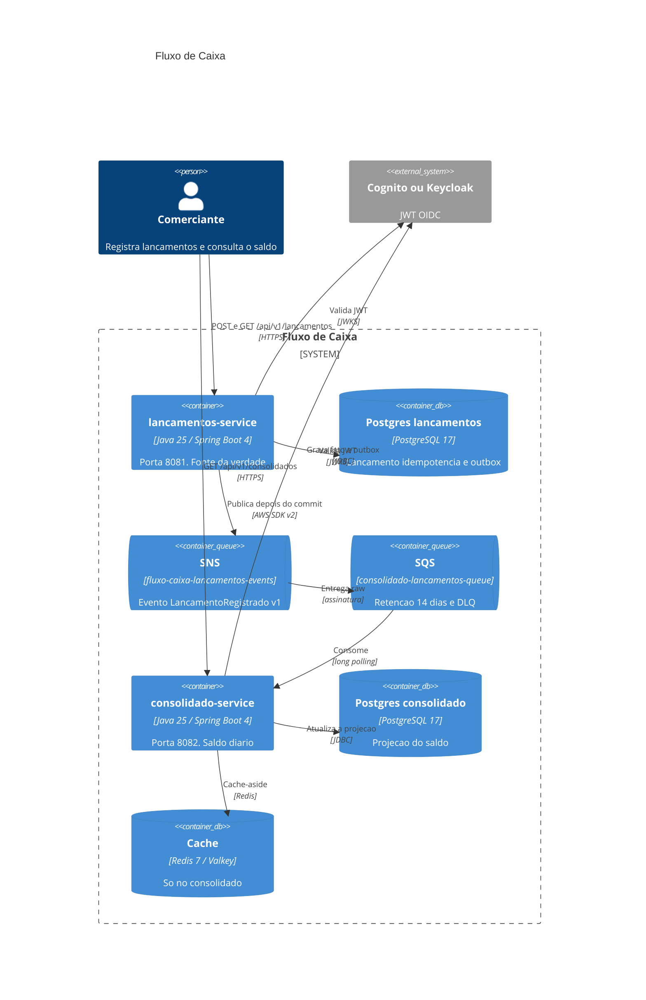

# Fluxo de Caixa

Sistema para um comerciante registrar créditos e débitos e consultar o saldo diário consolidado. A escrita do lançamento não depende do serviço de relatório: se o consolidado cair, o caixa continua aceitando movimento, e o saldo alcança o fato quando o consumidor volta.

O requisito que organiza a arquitetura é este: o controle de lançamentos permanece disponível se o consolidado diário cair; em pico, o consolidado atende **50 requisições por segundo** com **no máximo 5% de perda** (meta interna: 1%).

## Como o requisito é atendido

O `lancamentos-service` não chama o `consolidado-service`. O POST grava o lançamento e o evento na mesma transação (tabela `outbox_eventos`) e responde. Um relay publica no tópico cujo ARN vem de `LANCAMENTOS_TOPIC_ARN`. O consolidado consome a fila em `CONSOLIDADO_QUEUE_URL` (retenção de 14 dias, DLQ após 5 tentativas), aplica a soma uma única vez por `eventId` e serve a leitura por uma projeção em Postgres mais cache. No laboratório os nomes são `fluxo-caixa-lancamentos-events` e `consolidado-lancamentos-queue`. Na AWS o nome leva o prefixo do ambiente (`fluxo-caixa-dev-` ou `fluxo-caixa-prod-`); o serviço não tem nome de fila fixo no código. A conta de capacidade (Little: 2,8 requisições em voo no pico, duas tasks, cerca de 17% de utilização, 0,16 conexão de banco ativa) está em [docs/01-contexto-e-requisitos.md](docs/01-contexto-e-requisitos.md#analise-do-rnf-critico).



## Stack

| Peça | Escolha |
|---|---|
| Aplicação | Java 25, Spring Boot 4, Maven wrapper, um projeto por serviço |
| Arquitetura | Dois microsserviços, hexagonal, CQRS, outbox, consumidor idempotente |
| Dados | PostgreSQL 17, um banco por serviço, Flyway. RDS Multi-AZ em produção |
| Mensageria | SNS + SQS + DLQ. LocalStack no laboratório. AWS SDK v2 |
| Cache | Redis 7 local, Valkey no ElastiCache, só no consolidado |
| Segurança | OAuth2/OIDC. Cognito na AWS, Keycloak no local. JWT validado no serviço |
| Borda | ALB + WAF, região `sa-east-1` |
| Execução | ECS Fargate (ARM) |
| Observabilidade | OpenTelemetry. ADOT, CloudWatch e X-Ray na AWS. Grafana LGTM no local |
| Infra | Terraform (provider AWS 6.x) |

Licença de runtime: nenhuma paga. Detalhe e a estimativa de infra alinhada ao Terraform (produção em São Paulo cerca de **USD 1.214/mês**; dev AWS ligado o mês inteiro cerca de **USD 385/mês**; local **USD 0**) em [docs/08-custos.md](docs/08-custos.md).

## Estrutura do repositório

```text
fluxo-caixa/
├── README.md
├── Makefile
├── docs/                          # documentação de entrega e blueprint
├── services/
│   ├── lancamentos-service/       # porta 8081
│   └── consolidado-service/       # porta 8082
├── infra/
│   ├── terraform/                 # dev e prod
│   └── local/                     # docker-compose
├── tests/
│   ├── load/                      # k6
│   └── e2e/                       # smoke.sh e resiliencia.sh
└── .github/workflows/
```

O contrato compartilhado (paths, evento, nomes de fila, variáveis, portas) está em [docs/blueprint-tecnico.md](docs/blueprint-tecnico.md). A narrativa de arquitetura começa em [docs/README.md](docs/README.md).

## Pré-requisitos

- Java 25 (Temurin).
- Docker com Compose v2.
- Make.
- Opcional: k6 (`make load`), Terraform e AWS CLI (deploy).

O Maven não precisa estar instalado: cada serviço traz `mvnw`.

## Subir no local

Na raiz do repositório:

```bash
make infra-up
make up
```

`make infra-up` sobe a infraestrutura local. `make up` sobe os dois serviços.

| Serviço | URL |
|---|---|
| Keycloak | http://localhost:8080 (realm `fluxo-caixa`) |
| Lançamentos | http://localhost:8081 |
| Consolidado | http://localhost:8082 |
| Swagger lançamentos | http://localhost:8081/swagger-ui.html |
| Swagger consolidado | http://localhost:8082/swagger-ui.html |
| OpenAPI | http://localhost:8081/v3/api-docs e http://localhost:8082/v3/api-docs |
| Grafana (otel-lgtm) | http://localhost:3000 |
| Postgres | localhost:5432, bancos `lancamentos` e `consolidado` |
| Redis | localhost:6379 |
| LocalStack | http://localhost:4566 |

Usuário de laboratório: `comerciante1` / `comerciante1`, com `comerciante_id` `11111111-1111-1111-1111-111111111111`. Quando o Grafana pedir senha, a padrão da imagem `grafana/otel-lgtm` é `admin` / `admin`.

Para derrubar: `make down`.

### Token

```bash
TOKEN=$(make token)
```

`make token` imprime o access token do `comerciante1` no stdout (client `fluxo-caixa-app`, direct access grant no Keycloak local).

### Registrar um crédito

```bash
curl -sS -X POST http://localhost:8081/api/v1/lancamentos \
  -H "Authorization: Bearer $TOKEN" \
  -H "Content-Type: application/json" \
  -H "Idempotency-Key: $(uuidgen)" \
  -d '{"tipo":"CREDITO","valor":150.00,"dataLancamento":"2026-11-10","descricao":"Venda balcão","categoria":"VENDAS"}'
```

A primeira resposta é **201**. Repetir com a mesma `Idempotency-Key` e o mesmo corpo devolve **200** e o mesmo recurso, sem segundo lançamento. O `comercianteId` não vai no JSON: o serviço lê o claim do token.

### Consultar o lançamento e o dia

```bash
curl -sS http://localhost:8081/api/v1/lancamentos/COLE_O_ID \
  -H "Authorization: Bearer $TOKEN"

curl -sS "http://localhost:8081/api/v1/lancamentos?data=2026-11-10&page=0&size=50" \
  -H "Authorization: Bearer $TOKEN"
```

### Estornar

```bash
curl -sS -X POST http://localhost:8081/api/v1/lancamentos/COLE_O_ID/estornos \
  -H "Authorization: Bearer $TOKEN" \
  -H "Content-Type: application/json" \
  -d '{"motivo":"Valor digitado errado"}'
```

O estorno é um lançamento novo, de tipo oposto, na mesma data de competência. O original não muda.

### Saldo consolidado

O saldo é eventual (meta p95 abaixo de 5 s). Se o GET vier zerado logo depois do POST, espere um instante e repita.

```bash
curl -sS http://localhost:8082/api/v1/consolidados/diario/2026-11-10 \
  -H "Authorization: Bearer $TOKEN"

curl -sS "http://localhost:8082/api/v1/consolidados/diario?inicio=2026-11-01&fim=2026-11-10" \
  -H "Authorization: Bearer $TOKEN"
```

Dia sem movimento responde **200** com zeros. Período maior que 366 dias responde **400** `application/problem+json`.

Escopos exigidos: `lancamentos:write`, `lancamentos:read`, `consolidado:read`. No local o prefixo é vazio. Na AWS a autoridade leva o prefixo `fluxo-caixa/`.

## Testes

```bash
make test          # unidade, ArchUnit e integração (Testcontainers)
make smoke         # jornada ponta a ponta
make resiliencia   # consolidado parado, POST segue, fila recupera
make load          # k6, opcional
make tf-validate   # Terraform fmt e validate
```

O que cada camada cobre está em [docs/11-testes.md](docs/11-testes.md).

## Deploy na AWS

Produção em `sa-east-1`: VPC em três zonas, ALB com WAF, ECS Fargate com no mínimo duas tasks por serviço, RDS PostgreSQL separado e Multi-AZ para cada serviço, ElastiCache com réplica, SNS/SQS/DLQ, Cognito e ADOT. O passo a passo de apply, state e variáveis fica em [infra/terraform/README.md](infra/terraform/README.md). A topologia e o DR estão em [docs/03-arquitetura/deployment-aws.md](docs/03-arquitetura/deployment-aws.md). O deploy da aplicação é rolling com circuit breaker e rollback ([ADR 0020](docs/04-adr/0020-estrategia-de-deploy.md)).

## Documentação

| Documento | Conteúdo |
|---|---|
| [Índice](docs/README.md) | Mapa de toda a entrega |
| [Blueprint](docs/blueprint-tecnico.md) | Contrato: nomes, portas, evento, SLOs |
| [Requisitos](docs/01-contexto-e-requisitos.md) | RF, RNF e capacidade |
| [Domínio](docs/02-dominio-ddd.md) | DDD, context map, evento |
| [Arquitetura](docs/03-arquitetura/README.md) | C4, fluxos, AWS, Structurizr |
| [ADRs](docs/04-adr/README.md) | Vinte decisões, de 0001 a 0020 |
| [RNF operacionais](docs/05-requisitos-nao-funcionais.md) | SLO, error budget, k6 |
| [Segurança](docs/06-seguranca.md) | STRIDE, OWASP API, LGPD |
| [Observabilidade](docs/07-observabilidade.md) | Métricas, alarmes, runbooks |
| [Custos](docs/08-custos.md) | USD e BRL, dev e prod, licenças |
| [Transição](docs/09-arquitetura-de-transicao.md) | Strangler a partir do legado |
| [Evoluções](docs/10-evolucoes-futuras.md) | O que ficou de fora e por quê |
| [Testes](docs/11-testes.md) | Pirâmide e comandos |

## Saúde dos processos

O ALB usa readiness. No local:

- http://localhost:8081/actuator/health/liveness
- http://localhost:8081/actuator/health/readiness
- http://localhost:8082/actuator/health/readiness

Métrica Prometheus: `/actuator/prometheus` em cada serviço (não publicada na internet em produção).
