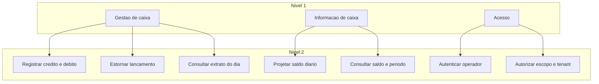
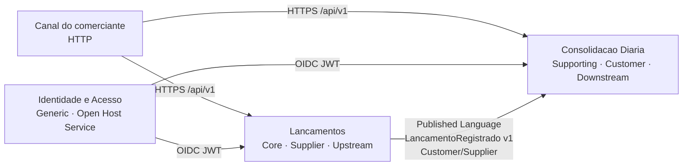
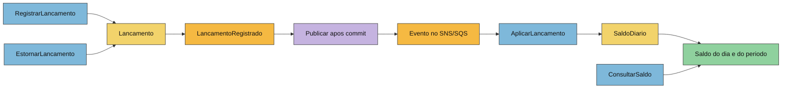
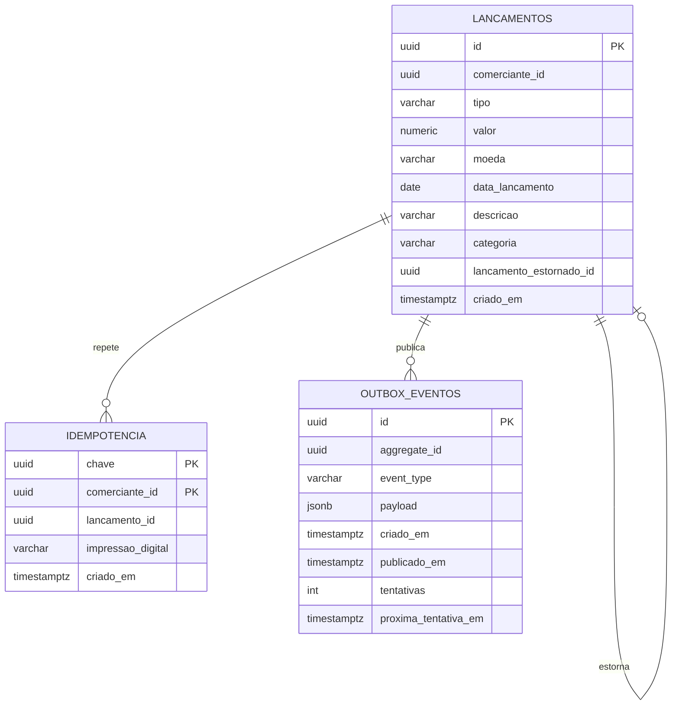
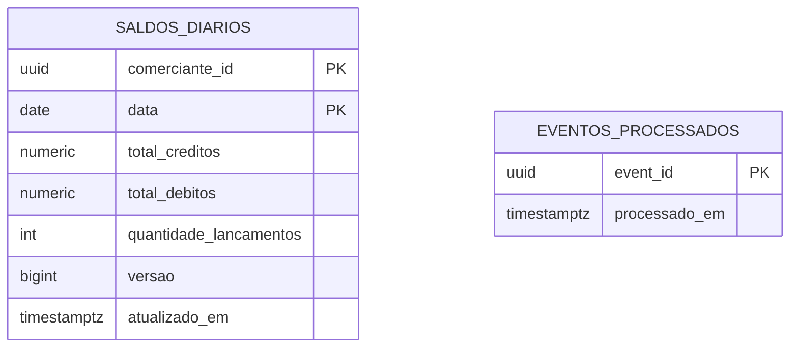

# 02 — Domínio (DDD)

Complementa o [blueprint §4 a §6](blueprint-tecnico.md). Onde o blueprint já fixou nome, invariante ou JSON, este texto não inventa outro contrato: explica o mapa, o storming e o modelo físico.

## 1. Capacidades de negócio

Nível 1 é o que a organização precisa saber fazer. Nível 2 é o que um sistema pode automatizar.



| Capacidade nível 1 | Nível 2 | Contexto que realiza |
|---|---|---|
| Gestão de caixa | Registrar crédito e débito, estornar, consultar extrato | Lançamentos |
| Informação de caixa | Projetar saldo diário, consultar dia e período | Consolidação diária |
| Acesso | Autenticar, autorizar por escopo e por comerciante | Identidade e acesso |

A cadeia de valor cabe em uma frase: o comerciante registra o fato, o fato é durável mesmo sem relatório, e o relatório alcança o fato em segundos.

## 2. Subdomínios

O blueprint classifica Consolidação como **Core/Supporting**. As duas palavras estão certas em camadas diferentes, e misturá-las sem dizer isso confunde o investimento.

| Subdomínio | Classe no produto | Classe DDD | Por quê |
|---|---|---|---|
| Gestão de lançamentos | Core | **Core** | Imutabilidade, estorno único, dinheiro e competência são a regra que diferencia um caixa auditável de uma planilha editável. Fonte da verdade. |
| Consolidação diária | Core para a proposta de valor (o comerciante compra o saldo) | **Supporting** | É projeção determinística do core. A regra nova é pouca: somar, não duplicar, calcular acumulado. Não decide se um lançamento existe. |
| Identidade e acesso | Higiene | **Generic** | OAuth2/OIDC não é diferencial. Cognito na AWS, Keycloak no laboratório. |
| Observabilidade, mensageria, execução | Plataforma | **Generic** | SNS/SQS, ECS, OTel. Comprados ou adotados, não modelados como domínio. |

Consequência prática: o tempo de design vai para as invariantes do `Lancamento` e para o contrato do evento. O consolidado não ganha regra paralela de “interpretação” do estorno. Um estorno é só outro `LancamentoRegistrado` com tipo oposto.

## 3. Bounded contexts

| Contexto | Serviço | Modelo que protege |
|---|---|---|
| Lançamentos (Gestão de Caixa) | `lancamentos-service` | Agregado `Lancamento`, VO `Dinheiro`, estorno |
| Consolidação diária | `consolidado-service` | Agregado `SaldoDiario`, read models de dia e período |
| Identidade e acesso | Cognito / Keycloak | Usuário, client, escopos, claim `comerciante_id` |

Pacotes: `br.com.fluxocaixa.lancamentos` e `br.com.fluxocaixa.consolidado`.

Não há contexto de “Comerciante” neste sistema. O identificador chega pronto no token. Criar um serviço de cadastro agora seria um terceiro deploy sem requisito.

## 4. Context map

Padrões usados de propósito:

- **Customer/Supplier.** O consolidado é o customer: precisa do evento e não pode exigir mudança silenciosa no core. Lançamentos é o supplier: não consulta o consolidado e não falha se ele estiver fora.
- **Published Language.** O JSON versionado da seção 6 do blueprint é a linguagem publicada. Não é o modelo interno de nenhum dos dois.
- **Conformista, no sentido do relacionamento.** O downstream aceita a semântica do evento (soma comutativa, estorno = lançamento oposto). Não renegocia o fato.
- **ACL no adaptador.** O listener SQS traduz JSON em comando de aplicação. A entidade `SaldoDiario` não conhece `eventVersion`, SNS nem o formato string do valor. Conformista no negócio, anticorruptor na borda técnica — é o que o blueprint pede ao dizer “downstream conformista com uma camada anticorrupção no adaptador de mensageria”.
- **Open Host Service.** Cada API REST `/api/v1` é um host aberto para o canal do comerciante (e para integrações futuras). O provedor de identidade é OHS de token. Não há protocolo privado entre os dois serviços além do evento publicado.



O que este mapa recusa: Partnership (os dois times não coevoluem o mesmo modelo), Shared Kernel (não há biblioteca de domínio compartilhada; duplicar o parse do valor na ACL é mais barato do que um acoplamento de release) e Conformist puro sem ACL (o JSON não entra no núcleo do consolidado).

## 5. Event storming

Fluxo do lançamento até a leitura. Cores: comando azul, evento laranja, agregado amarelo, política roxa, read model verde.



| Elemento | Tipo | Contexto | Notas |
|---|---|---|---|
| `RegistrarLancamento` | Comando | Lançamentos | POST `/api/v1/lancamentos`. Carrega tipo, valor, data, descrição, categoria, chave de idempotência opcional. |
| `EstornarLancamento` | Comando | Lançamentos | POST `.../{id}/estornos`. Falha se já estornado ou se o alvo já é estorno. |
| `ConsultarLancamento` / `ListarLancamentosDoDia` | Comando de leitura | Lançamentos | Leitura no próprio contexto. Não passa pelo consolidado. |
| `Lancamento` | Agregado | Lançamentos | Imutável após criado. |
| `LancamentoRegistrado` | Evento de domínio e de integração | Lançamentos → publicado | Mesmo nome nos dois papéis. A versão de integração é o JSON v1. |
| Publicar após o commit | Política | Lançamentos | Outbox + relay. Não é parte da transação visível ao cliente. |
| `AplicarLancamento` | Comando interno | Consolidação | Disparado pelo listener, não por HTTP. |
| `SaldoDiario` | Agregado | Consolidação | Chave `(comercianteId, data)`. |
| `EventoJaProcessado` | Política | Consolidação | Se `eventId` existe, o comando vira no-op. |
| `SaldoDoDia` / `RelatorioPeriodo` | Read models | Consolidação | Servidos pela API. Cache na frente. |
| `ConsultarSaldoDiario` / `ConsultarPeriodo` | Comando de leitura | Consolidação | GET. Dia vazio responde zeros. |

Não há evento `LancamentoEstornado`. O estorno é um `LancamentoRegistrado` com `lancamentoEstornadoId` preenchido. Um segundo tipo de evento obrigaria o consumidor a conhecer uma máquina de estados que o domínio de escrita já resolveu.

## 6. Modelo tático — Lançamentos

### Agregado `Lancamento`

Raiz de agregado. Identidade `id` (UUID; preferência por UUID v7 pela ordenação temporal, v4 aceito pelo blueprint). Não há coleção interna: um lançamento não contém outro. O vínculo de estorno é uma referência por id, não um grafo carregado junto.

| Atributo | Tipo | Regra |
|---|---|---|
| `id` | UUID | Gerado pelo serviço. |
| `comercianteId` | UUID | Vem do token. |
| `tipo` | `CREDITO` ou `DEBITO` | Fechado. |
| `valor` | VO `Dinheiro` | `BigDecimal` escala 2, `> 0`, moeda `BRL`. |
| `dataLancamento` | `LocalDate` | Competência. |
| `descricao` | texto 1..255 | Obrigatória. |
| `categoria` | texto até 60 ou nulo | Opcional. Não entra no evento v1. |
| `lancamentoEstornadoId` | UUID ou nulo | Preenchido somente em estorno. |
| `criadoEm` | `Instant` | UTC. |

### Value object `Dinheiro`

Imutável. Construtor rejeita escala maior que 2, sinal errado e moeda diferente de BRL. Igualdade por valor e moeda. A borda HTTP converte o número JSON do request (exemplo do blueprint: `150.00`) para `Dinheiro` via `BigDecimal`, nunca via `double`. A borda de mensagem serializa com `toPlainString` de duas casas (`"150.00"`).

### Invariantes

1. Valor positivo com no máximo duas casas, moeda BRL.
2. Descrição presente e dentro do tamanho.
3. Um lançamento é estornado no máximo uma vez. A unicidade é restrição de persistência (índice único parcial em `lancamento_estornado_id`), não só checagem em memória.
4. Lançamento que já é estorno não pode ser estornado.
5. O estorno copia valor, moeda e `dataLancamento` do original e inverte o tipo.
6. Não há operação de alteração nem de exclusão.

### Evento de domínio

`LancamentoRegistrado` carrega o mínimo para um consumidor recalcular saldo: ids, tipo, valor, moeda, data de competência, id do estornado, `eventId`, `eventVersion`, `occurredAt`. Descrição e categoria ficam de fora de propósito: são dado operacional do extrato, não da soma, e reduzem o acoplamento e a superfície de dado pessoal replicado.

## 7. Modelo tático — Consolidação

### Agregado `SaldoDiario`

Identidade natural `(comercianteId, data)`. Nasce na primeira aplicação de evento daquele dia.

| Atributo | Regra |
|---|---|
| `totalCreditos`, `totalDebitos`, `saldo` | `saldo = totalCreditos − totalDebitos`. Mantidos juntos para o GET do dia ser uma linha. |
| `quantidadeLancamentos` | Incrementa 1 por evento novo, inclusive estorno. |
| `versao` | Lock otimista. Dois eventos do mesmo dia em paralelo: um faz retry e reaplica. A soma é comutativa, então a ordem não muda o resultado. |
| `atualizadoEm` | Instante da última aplicação. |

`saldoAcumulado` **não é coluna**. É calculado na consulta: `SUM(saldo)` das datas `≤` a data pedida. Materializar o acumulado em cada linha futura transformaria um estorno antigo em atualização em cadeia. Com centenas de linhas por comerciante, o `SUM` indexado é mais simples e cabe no orçamento de latência da [análise de capacidade](01-contexto-e-requisitos.md#analise-do-rnf-critico).

### Idempotência

Tabela `eventos_processados(event_id PK)` escrita na mesma transação que faz o UPSERT de `saldos_diarios`. Entrega at-least-once do SQS deixa de ser problema de negócio.

### Read models

- **Saldo do dia:** uma linha de `saldos_diarios` mais o `SUM` do saldo acumulado. Ausência da linha vira zeros e o acumulado dos dias anteriores. O saldo do dia não é coluna: é `total_creditos - total_debitos`.
- **Período:** uma linha por dia do intervalo, limite 366 dias, dias sem movimento preenchidos com zero na aplicação.

### Cache

O cache não é fonte da verdade. Chave com geração por comerciante:

```text
consolidado:versao:{comercianteId}
consolidado:dia:{comercianteId}:{versao}:{data}
consolidado:relatorio:{comercianteId}:{versao}:{inicio}:{fim}
```

Cada evento aplicado faz `INCR` na versão daquele comerciante depois do commit. Chaves velhas expiram por TTL de 30 s. Isso invalida o dia alterado, os acumulados posteriores e os relatórios de período sem uma lista de deletes. Dia corrente e dia antigo seguem a mesma regra, porque estorno retroativo existe (RF-18).

## 8. Modelo de dados — Lançamentos



Índices e restrições da migração `V1__criar_tabelas.sql`:

- `idx_lancamentos_comerciante_data` em `(comerciante_id, data_lancamento)`.
- `UNIQUE (lancamento_estornado_id)`. No PostgreSQL vários nulos coexistem; um original só pode ser referenciado uma vez.
- `idx_outbox_eventos_pendentes` em `(proxima_tentativa_em, criado_em)` onde `publicado_em` é nulo.
- `idempotencia` chave primária `(chave, comerciante_id)`. `impressao_digital` é `VARCHAR(64)`, o SHA-256 hex do corpo.

`valor` é `NUMERIC(19,2)`. `moeda` é `VARCHAR(3)` com check `BRL`.

## 9. Modelo de dados — Consolidado



Não há coluna `saldo`. A consulta calcula `total_creditos - total_debitos`. O `versao` da linha é um contador do UPSERT, diferente da versão do cache Redis.

Não há chave estrangeira para o banco de lançamentos. A referência é o `lancamentoId` dentro do payload já aplicado; ele não é coluna obrigatória do saldo, porque o saldo é soma, não extrato. Guardar o id na projeção seria um extrato duplicado.

## 10. Contrato do evento

No local o tópico SNS é `fluxo-caixa-lancamentos-events`. Na AWS o nome leva o prefixo do ambiente e o serviço só conhece `LANCAMENTOS_TOPIC_ARN`. Assinatura da fila com **raw message delivery**. O corpo no SQS é o JSON, sem envelope SNS. Atributo de mensagem `eventType` = `LancamentoRegistrado`.

```json
{
  "eventId": "0b8f6c1e-6d1a-4b8e-9a43-0f1b7e2f9c11",
  "eventType": "LancamentoRegistrado",
  "eventVersion": 1,
  "occurredAt": "2026-11-10T18:00:00.123Z",
  "lancamentoId": "5f0e1c7a-1d2b-4c3d-8e9f-0a1b2c3d4e5f",
  "comercianteId": "11111111-1111-1111-1111-111111111111",
  "tipo": "CREDITO",
  "valor": "150.00",
  "moeda": "BRL",
  "dataLancamento": "2026-11-10",
  "lancamentoEstornadoId": null
}
```

Regras de evolução:

- Campo novo é aditivo e opcional. Consumidor antigo ignora.
- Quebra (remover campo, mudar unidade, mudar semântica de estorno) exige `eventVersion` 2 e um período em que o consumidor aceita as duas versões.
- `valor` permanece string. Número JSON no evento reintroduziria binário de ponto flutuante em alguma linguagem do outro lado.
- Entrega at-least-once. Ordenação não é garantida e não é necessária.
- O consumidor descarta versão que não conhece para a DLQ com erro explícito, em vez de aplicar pela metade.

## 11. Limites que o modelo ainda não tem

Categoria não segmenta o saldo. Dois créditos de categorias diferentes somam no mesmo `SaldoDiario`. Um relatório por categoria exigiria outro read model e o campo `categoria` no evento — evolução, não omissão acidental, descrita em [evoluções](10-evolucoes-futuras.md).

Não há conceito de “caixa fechado”. Um lançamento retroativo é sempre aceito. Travar competência é regra de um contexto futuro de fechamento, que hoje não existe; colocá-la dentro de `Lancamento` agora acoplaria o core a um processo que o enunciado não pediu.
