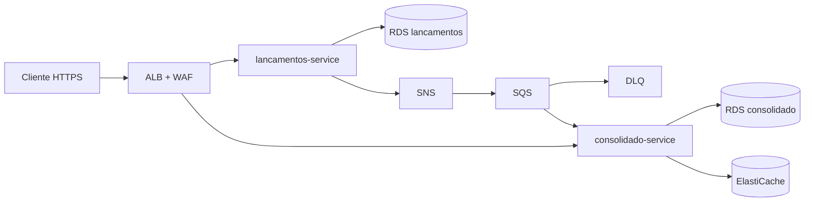

# Arquitetura-alvo

## 1. Visão

Dois microsserviços alinhados a bounded contexts, com CQRS entre a escrita de lançamentos e a leitura do saldo. A integração é assíncrona. O POST não espera o relatório. A durabilidade do fato fica no Postgres de lançamentos; a disponibilidade do relatório em pico fica numa projeção pequena, cache e duas tasks.

O RNF crítico cabe neste desenho: a seta entre os serviços aponta só para a direita e termina numa fila, não numa chamada bloqueante. A conta de 50 req/s, 2 tasks e 0,16 conexões ativas está em [contexto e requisitos](../01-contexto-e-requisitos.md#analise-do-rnf-critico).

## 2. Estilos e padrões

Cada padrão abaixo está adotado. O trade-off é o preço que aceitamos pagar.

### Microsserviços por bounded context

Dois deploys, dois bancos, dois ciclos de vida. Lançamentos pode ser implantado sem tocar no consolidado.

**Trade-off.** Operação duplicada (pipeline, alarme, RDS). Um monolito modular daria a mesma fronteira de código com um deploy só, e atenderia o isolamento lógico se o módulo de escrita não chamasse o de leitura. Não atenderia o isolamento de *processo e de banco* que o enunciado pede quando “o sistema de consolidado cair”: no mesmo processo, um vazamento de pool ou um crash derruba os dois. Serverless foi descartado pelo perfil de conexões longas com Postgres e pelo custo fixo de VPC em Lambda. Detalhe no [ADR 0002](../04-adr/0002-microsservicos-por-bounded-context.md).

### CQRS

A escrita persiste o fato. A leitura serve uma projeção com outro esquema (`saldos_diarios` não é a tabela `lancamentos`).

**Trade-off.** Dois modelos para manter e uma janela de consistência eventual (p95 &lt; 5 s). Em troca, o GET de pico não faz join no extrato, e o esquema da leitura pode ganhar índice e cache sem migrar a trilha de auditoria. [ADR 0003](../04-adr/0003-cqrs-e-integracao-assincrona.md).

### Event-driven

O fato vira `LancamentoRegistrado` v1. Novos consumidores (notificação, auditoria externa, categoria) assinam o tópico com fila própria, sem o de escrita conhecê-los.

**Trade-off.** Depuração deixa de ser uma stack única. Exige correlation id, outbox e consumidor idempotente. Sem isso, evento é perda silenciosa.

### Transactional outbox

Lançamento e linha em `outbox_eventos` no mesmo commit. Relay com `FOR UPDATE SKIP LOCKED`, lote 100, intervalo 500 ms.

**Trade-off.** Latência extra de até um ciclo do relay no caminho do evento (não no caminho do POST) e uma tabela para operar. Dual-write (commit e publish separados) perde evento ou publica evento de transação revertida. CDC com Debezium entrega o log, com um cluster a mais que este volume não paga. [ADR 0004](../04-adr/0004-transactional-outbox.md).

### Consumidor idempotente

`eventos_processados(event_id PK)` na mesma transação da soma. A fila é at-least-once e Standard (sem ordem). A soma é comutativa, então a ausência de FIFO é aceitável.

**Trade-off.** Toda mensagem custa um insert de id. É a alternativa barata a “processar exatamente uma vez”, que o SQS não oferece.

### Hexagonal

Domínio em Java puro, casos de uso nas portas, AWS e JPA nos adaptadores. ArchUnit no build.

**Trade-off.** Mais pacotes e mapeamentos. O ganho é poder testar estorno e dinheiro sem subir Spring, e trocar SNS por LocalStack sem editar regra. [ADR 0008](../04-adr/0008-arquitetura-hexagonal.md).

### Cache-aside

O consolidado consulta Redis no local e Valkey no ElastiCache e, no miss, o Postgres, depois preenche o cache. A chave carrega a versão corrente do comerciante (`consolidado:versao:{id}`), incrementada a cada evento. O TTL de 30 s (`app.cache.ttl`) só apaga chave órfã; a leitura seguinte já usa a versão nova.

**Trade-off.** Memória e um modo de falha a mais. Se o Redis cair, a leitura segue no Postgres: em 50 req/s com miss total são ~2 conexões ativas, dentro do `db.t4g.small`. O cache existe para o p95 &lt; 100 ms, não para a sobrevivência. [ADR 0012](../04-adr/0012-cache-redis-elasticache.md).

### Database per service

Cada serviço é dono do seu esquema e, em produção, da sua instância RDS. Não há `JOIN` entre lançamento e saldo, nem usuário de banco compartilhado.

**Trade-off.** Duas instâncias Multi-AZ custam mais do que um RDS com dois databases (a conta está no [documento 08](../08-custos.md)). O ganho é o de falha: esgotar conexão, disco ou IOPS do consolidado não tira o POST do ar. Em dev AWS as instâncias podem ser menores e Single-AZ; no Docker, um Postgres com dois databases basta.

### Retry com backoff e jitter, timeout, DLQ

- Relay: retenta o publish, incrementa `tentativas`, não segura a thread do POST.
- SQS: visibility 60 s, até 5 recebimentos, depois `consolidado-lancamentos-dlq`.
- Redis e JWKS: timeout curto e retry com jitter. Falha de Redis degrada para o banco.
- Não se retenta 4xx de domínio. Estorno inválido não melhora na segunda tentativa.

**Trade-off.** Retry sem idempotência duplicaria saldo. Os dois padrões andam juntos. [ADR 0014](../04-adr/0014-idempotencia.md).

### Circuit breaker

Há dois mecanismos com o mesmo nome, e eles não se misturam.

- **De deploy (ECS).** Circuit breaker com rollback automático se as tasks novas não ficam saudáveis. [ADR 0020](../04-adr/0020-estrategia-de-deploy.md).
- **De aplicação.** Não há Resilience4j. O starter `resilience4j-spring-boot4` disponível na época desta entrega depende do autoconfigure do Boot 4.0 e não entrou no classpath do Boot 4.1. O relay espaça a republicação com `outbox_eventos.proxima_tentativa_em` (backoff exponencial até 60 s). Redis, Hikari, Tomcat e o cliente SQS têm timeout curto. Falha de Redis não abre circuito: a leitura segue no Postgres. Não existe circuit breaker entre lançamentos e consolidado porque não existe chamada entre eles.

**Trade-off.** Sem breaker de cliente, uma indisponibilidade do SNS não falha rápido dentro do POST — o POST nem chama o SNS. O custo fica no relay, limitado pelo backoff e pelo lote de 100. Timeout mal calibrado no Redis transforma lentidão em miss, que é o comportamento desejado.

### Bulkhead

Pools JDBC separados, serviços ECS separados, filas separadas, bancos separados. Um consumidor lento não ocupa conexão do POST. O teto do pool é 10 no lançamentos e 20 no consolidado, por task.

**Trade-off.** Conexão ociosa (`minimumIdle` 2) custa slot no `max_connections`. O número foi escolhido na análise de capacidade para sobrar folga, não para “usar o banco inteiro”.

### DLQ

Quinta falha de processamento vai para `consolidado-lancamentos-dlq`. A fila principal segue. Reprocessar é uma ação operada (corrigir o consumidor e reenviar), descrita no [fluxo de DLQ](fluxos-de-dados.md) e no runbook.

**Trade-off.** Mensagem na DLQ é saldo atrasado para aquele evento até alguém agir. O alarme é imediato. Sem DLQ, um poison message seguraria a partição lógica atrás de retries infinitos — no Standard não bloqueia as outras, mas queimaria receive e esconderia o erro.

### API versionada e RFC 9457

Base `/api/v1`. Erro em `application/problem+json`. Evolução do evento por `eventVersion`. [ADR 0017](../04-adr/0017-api-rest-versionada-rfc9457.md).

**Trade-off.** URIs de problema e versões são contrato para sempre. O ganho é cliente que distingue 409 de estorno de 400 de payload sem parsear texto livre.

### Borda ALB + WAF, JWT no serviço

O ALB roteia `/api/v1/lancamentos*` e `/api/v1/consolidados*` para target groups diferentes e manda o health check em `/actuator/health/readiness`. O WAF aplica managed rules e rate-based. O JWT é validado no serviço, igual no Keycloak local e no Cognito.

**Trade-off.** O ALB não vende API key nem transformation. Não precisamos disso. API Gateway seria um hop e uma conta a mais, e um authorizer só na borda deixaria o serviço nu se alguém alcançasse a task. [ADR 0018](../04-adr/0018-borda-alb-waf.md).

### BFF / API Gateway — considerado e não adotado

Um BFF faria sentido com um frontend agregando saldo e extrato numa tela, escondendo os dois serviços. Não há frontend nesta entrega. Agregar no BFF agora criaria um terceiro serviço sem dono de negócio. O cliente chama os dois hosts paths no mesmo ALB. Quando existir canal web, o BFF entra na frente sem mudar o domínio — está no [roadmap](../10-evolucoes-futuras.md).

### Strangler Fig

Usado na transição a partir de planilha ou ERP, não no dia a dia dos dois serviços novos. Os dois serviços já nascem no contorno certo; não há monolito nosso para estrangular. O padrão está especificado no [documento 09](../09-arquitetura-de-transicao.md) para o legado do comerciante.

### Idempotência na borda HTTP

`Idempotency-Key` opcional, escopada pelo comerciante. Mesma chave e mesmo corpo: 201 na primeira vez, 200 na repetição. Corpo diferente: 409. [ADR 0014](../04-adr/0014-idempotencia.md).

### Lançamentos imutáveis

Correção é estorno. A trilha é a própria tabela, append-only. [ADR 0015](../04-adr/0015-lancamentos-imutaveis-estorno.md).

### Dinheiro

`BigDecimal` e `NUMERIC(19,2)` dentro; string de duas casas no evento. [ADR 0016](../04-adr/0016-representacao-monetaria.md).

## 3. O que a arquitetura-alvo deliberadamente não é

| Tentação | Por que não |
|---|---|
| Event sourcing do lançamento | O estado cabe numa linha. O evento de integração não precisa reconstruir o agregado. Reprocessar saldo a partir do tópico é evolução, não requisito. |
| Saga | Não há transação distribuída para compensar. O estorno é um fato novo, não um rollback do POST. |
| Service mesh | Dois serviços atrás de um ALB não pagam o custo de Istio/App Mesh. mTLS pode ser feito na evolução com VPC Lattice ou mesh quando houver dezenas de serviços. |
| Kafka / MSK | O volume da premissa (20 evt/s, 2 milhões/mês) é ruído para um cluster. SNS+SQS entrega DLQ, retenção e fan-out. [ADR 0005](../04-adr/0005-sns-sqs-mensageria.md). |

## 4. Como as qualidades caem nos padrões

| Qualidade | Padrão que a carrega |
|---|---|
| Lançamentos sobrevive ao consolidado | Assíncrono + outbox + fila + banco separado |
| 50 req/s com perda baixa | Projeção + cache + 2 tasks com ρ ≈ 17% + WAF acima do pico |
| Auditoria | Append-only e estorno |
| Isolamento de tenant | Claim no token, filtro em toda query |
| Evolução do contrato | `/api/v1` e `eventVersion` |
| Custo proporcional | Fargate, RDS small, fila gerenciada; NAT e endpoint são o custo fixo a vigiar |
