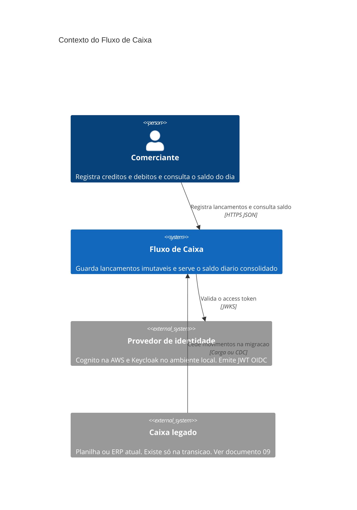

# C4 — Nível 1: contexto

O comerciante usa o Fluxo de Caixa para registrar movimentos e ler o saldo. O sistema delega a autenticação a um provedor de identidade e, na implantação AWS, se apoia em serviços gerenciados de mensageria, dados e observabilidade. Esses serviços aparecem no [nível 2](c4-nivel2-containers.md) e na [implantação](deployment-aws.md); aqui ficam de fora para o diagrama mostrar só quem fala com quem no negócio.

| Ator ou sistema | Responsabilidade na fronteira |
|---|---|
| Comerciante | Pessoa ou sistema dele (PDV, app) que chama a API. Não escolhe o tenant: o token já o traz. |
| Fluxo de Caixa | Dois serviços. Escrita durável de lançamentos e leitura eventual do saldo. |
| Provedor de identidade | Autentica, emite escopos `lancamentos:write`, `lancamentos:read`, `consolidado:read` e o claim `comerciante_id`. |
| Caixa legado | Fora do caminho de produção do dia zero. Entra na [arquitetura de transição](../09-arquitetura-de-transicao.md). |

O diagrama de contexto de propósito não mostra SNS, RDS nem fila. Se eles aparecem aqui, o leitor confunde mecanismo com capacidade.
