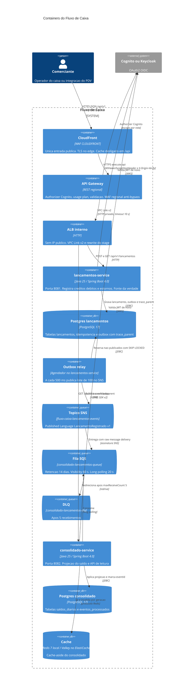

# C4 — Nível 2: containers

Dois processos, dois bancos, um tópico, uma fila e uma DLQ. Cache só no consolidado. Identidade fora dos dois serviços.

O relay está desenhado como container lógico. No deploy ele é um agendador dentro do processo do `lancamentos-service`, não um terceiro serviço. Separá-lo no diagrama deixa visível que a publicação não está no caminho do POST. Subir um processo exclusivo de relay só vale se o agendamento competir com a API por CPU — não é o caso em 20 escritas/s.

| Container | Escala | Estado |
|---|---|---|
| CloudFront + WAF | Distribuição global, PoP GRU | Sem estado de negócio. `/api/*` não é cacheado. |
| API Gateway REST | Regional, stage `v1` | Sem estado de negócio. Rejeita JWT inválido antes da VPC. |
| ALB interno | Um, nas subnets privadas | Sem IP público. Dois target groups. Aceita o VPC Link. |
| `lancamentos-service` | 2+ tasks ECS em prod | Stateless. Estado no RDS de lançamentos. |
| `consolidado-service` | 2+ tasks ECS em prod | Stateless. Estado no RDS de consolidado e no cache. |
| Postgres (cada um) | RDS Multi-AZ em produção | Fonte durável. |
| SNS, SQS, DLQ | Gerenciados | Buffer entre os contextos. |
| Redis / Valkey | Réplica com failover em produção | Descartável. Perda do cache só aumenta latência. |
| Cognito / Keycloak | Gerenciado / container local | Fora do domínio. |

Portas locais: lançamentos 8081, consolidado 8082, Postgres 5432, Redis 6379, LocalStack 4566, Keycloak 8080, Grafana 3000, OTLP 4317 e 4318. Na AWS o cliente fala só com o CloudFront em 443. O API Gateway é regional e não é a URL que se publica. O ALB é interno, sem IP público, e as portas dos serviços ficam na rede privada. O relay continua sendo um agendador dentro do `lancamentos-service`, desenhado à parte para deixar visível que a publicação não está no caminho do POST. Com `enable_api_gateway = false`, o CloudFront volta a falar com o ALB pela VPC Origin e o container do gateway sai do caminho.
