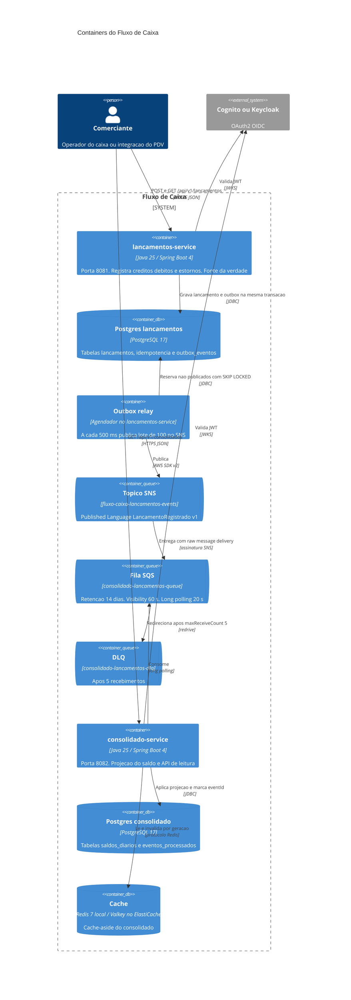

# C4 — Nível 2: containers

Dois processos, dois bancos, um tópico, uma fila e uma DLQ. Cache só no consolidado. Identidade fora dos dois serviços.

O relay está desenhado como container lógico. No deploy ele é um agendador dentro do processo do `lancamentos-service`, não um terceiro serviço. Separá-lo no diagrama deixa visível que a publicação não está no caminho do POST. Subir um processo exclusivo de relay só vale se o agendamento competir com a API por CPU — não é o caso em 20 escritas/s.

| Container | Escala | Estado |
|---|---|---|
| `lancamentos-service` | 2+ tasks ECS | Stateless. Estado no RDS de lançamentos. |
| `consolidado-service` | 2+ tasks ECS | Stateless. Estado no RDS de consolidado e no cache. |
| Postgres (cada um) | RDS Multi-AZ em produção | Fonte durável. |
| SNS, SQS, DLQ | Gerenciados | Buffer entre os contextos. |
| Redis / Valkey | Réplica com failover em produção | Descartável. Perda do cache só aumenta latência. |
| Cognito / Keycloak | Gerenciado / container local | Fora do domínio. |

Portas locais: lançamentos 8081, consolidado 8082, Postgres 5432, Redis 6379, LocalStack 4566, Keycloak 8080, Grafana 3000, OTLP 4317 e 4318. Na AWS o cliente fala só com o ALB em 443; as portas dos serviços ficam na rede privada.
