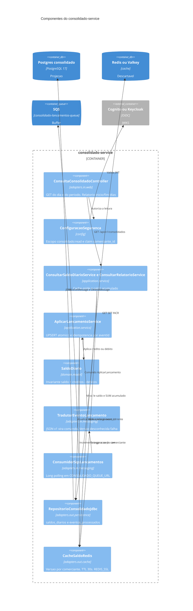

# C4 — Nível 3: componentes do consolidado-service

Pacote `br.com.fluxocaixa.consolidado`. O HTTP só lê. Quem escreve a projeção é o listener SQS.

| Decisão local | Efeito |
|---|---|
| ACL no `TradutorEventoLancamento`, não no agregado | `SaldoDiario` não conhece JSON. |
| `eventos_processados` na mesma transação do UPSERT | `ON CONFLICT DO NOTHING` no evento e `ON CONFLICT DO UPDATE` somando em `saldos_diarios`. Reentrega não duplica saldo. Não há lock otimista. |
| Falha de parse ou versão ignorada | A mensagem volta após o visibility timeout e, na quinta vez, cai na DLQ. Não se aplica “no melhor esforço”. |
| Redis fora | O caso de uso lê o Postgres. Latência piora, disponibilidade da leitura permanece, dentro do que o RDS aguenta (ver capacidade). |
| Geração de cache | Um estorno em data antiga invalida acumulado e período daquele comerciante sem varrer chave por chave. |

Não há porta de saída para o `lancamentos-service`. O consolidado não pergunta “qual é o lançamento?”. Se o evento não basta, o contrato está incompleto e a correção é versão nova do evento, não uma chamada síncrona de volta.
