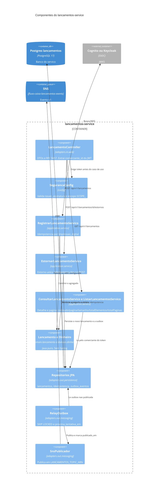

# C4 — Nível 3: componentes do lancamentos-service

Arquitetura hexagonal no pacote `br.com.fluxocaixa.lancamentos`. Regra verificada por ArchUnit: `domain` não depende de Spring nem de `adapters`; `application` não depende de `adapters`.

| Porta | Implementação | Observação |
|---|---|---|
| Entrada HTTP | `adapters/in/web` | Única porta síncrona. Não há listener de mensagem neste serviço. |
| Entrada de aplicação | `application.port.in` implementado em `application.servico` | O controller não calcula estorno. |
| Saída de persistência | JPA em `adapters.out.persistence` | Uma transação cobre lançamento, idempotência e outbox. |
| Saída de mensagem | `RelayOutbox` e `SnsPublicador` | Fora da transação do POST. Falha aqui não desfaz o 201. O nome do tópico não está no código. |

O domínio não importa `software.amazon.awssdk` nem `org.springframework`. O teste de arquitetura quebra o build se isso acontecer.
