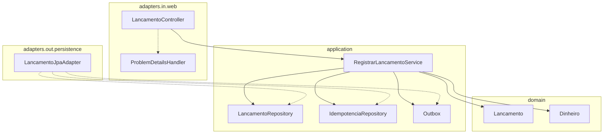
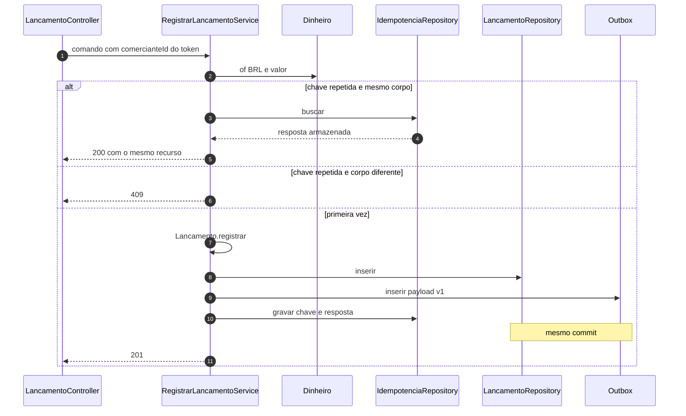

# C4 — Nível 4: registrar lançamento

Nível de código do caso de uso que segura o RNF de independência. As classes abaixo são o alvo da implementação em `services/lancamentos-service`; os nomes de pacote são os do blueprint. Não há framework no miolo.

Sequência interna, já com a transação no lugar certo:

Pontos que o código não pode “simplificar”:

- O controller lê `comerciante_id` do `Jwt` e não de um campo do JSON. Se o JSON trouxer o campo, ele é ignorado.
- `Dinheiro.of` rejeita escala e sinal antes de qualquer `INSERT`.
- `Outbox.inserir` participa da transação do repositório. Publicar SNS dentro desse método quebraria o desenho: o SDK é chamado só pelo relay, depois do commit.
- A resposta 201 devolve `valor` como string de duas casas, alinhada ao evento e ao [ADR 0016](../04-adr/0016-representacao-monetaria.md). O request continua aceitando número JSON, como no exemplo do blueprint.

O estorno segue o mesmo desenho, com `Lancamento.estornar(original)` no domínio devolvendo ou uma falha de invariante ou um novo `Lancamento`. A checagem “já estornado” é repetida pelo índice único: duas requisições paralelas não criam dois estornos.
