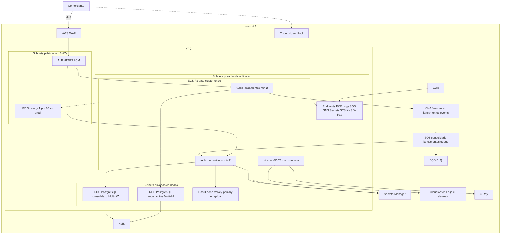

# Deployment na AWS

Região `sa-east-1`. A topologia abaixo é a de produção descrita no blueprint: VPC em três zonas, NAT por zona, endpoints de interface, ALB público com WAF, ECS Fargate, dois RDS Multi-AZ, ElastiCache com réplica, SNS/SQS/DLQ, Cognito e ADOT. O ambiente `dev` na conta AWS reduz NAT para um e pode usar RDS Single-AZ; o dia a dia do desenvolvedor é o Docker local, com custo de nuvem zero.

## 1. Diagrama

S3 entra como gateway endpoint (sem custo horário) para o pull de camadas via ECR. A lista de interface do Terraform é: ECR api, ECR dkr, CloudWatch Logs, SQS, SNS, Secrets Manager, STS, KMS e X-Ray. KMS e X-Ray não estão na lista mínima do blueprint; existem para a CMK e o sidecar ADOT não saírem por NAT.

## 2. Rede

| Camada | Quem mora | Regra |
|---|---|---|
| Pública | ALB, NAT | Só 443 no ALB, a partir da internet. NAT não tem rota de entrada. |
| Aplicação | Tasks ECS, endpoints | Sem IP público. Security group aceita tráfego do ALB na porta do serviço e egress para RDS, Redis, endpoints e NAT. |
| Dados | RDS, ElastiCache | Security group aceita 5432 só do SG de lançamentos ou só do SG de consolidado, conforme o banco. 6379 só do SG do consolidado. |

Três AZs permitem perder uma zona e ainda agendar task nas outras duas. O mínimo de duas tasks usa `spread` por AZ. NAT por AZ evita que a queda de uma zona leve embora o egress das outras; o preço disso está explícito no [custo](../08-custos.md) (três NATs em `sa-east-1` são a segunda maior linha fixa).

## 3. Borda

- ACM na região, TLS 1.2+.
- Listener 443 com duas regras de path: `/api/v1/lancamentos*` → target group de lançamentos; `/api/v1/consolidados*` → target group do consolidado. Health check: `GET /actuator/health/readiness`.
- WAF na frente do ALB, também em dev: AWS Managed Rules (Common, Known Bad Inputs, SQLi, IP Reputation) e uma regra rate-based. O limite da rate-based precisa ficar **acima** do pico legítimo de um cliente que concentre o fechamento; 50 req/s é o pico do serviço, não necessariamente de um IP só. Calibrar com o tráfego real e começar folgado, senão o WAF vira a causa da “perda de 5%”. O exemplo deixa o limite em 30.000 requests por IP a cada 5 minutos.
- Acesso a `/actuator` que não seja health fica fechado no security group ou em porta de gestão não publicada no ALB. Prometheus `/actuator/prometheus` não é rota pública.

## 4. Computação

| Serviço ECS | Task em prod | Mínimo | Máximo | Escala |
|---|---|---|---|---|
| `lancamentos` | 0,5 vCPU, 1 GiB, ARM64, sidecar ADOT incluso | 2 | 6 | CPU 60% e `ALBRequestCountPerTarget` (600/min por task) |
| `consolidado` | 1 vCPU, 2 GiB, ARM64, sidecar incluso | 2 | 10 | CPU 60%, `ALBRequestCountPerTarget` (1.500/min por task) e backlog da fila (20 mensagens visíveis por task) |

Deployment circuit breaker com rollback. O detalhe de rolling e a evolução para blue/green está no [ADR 0020](../04-adr/0020-estrategia-de-deploy.md).

A task de 1 vCPU do consolidado é maior do que o pico de 50 req/s exige (a conta dá ρ de 17% com duas tasks a 150 req/s cada). O tamanho existe para caber o sidecar e o JIT, não porque o modelo de fila peça essa CPU. O lançamentos fica em 0,5 vCPU porque o caminho de escrita é mais curto. Dev usa 0,25/0,5 GiB e 0,5 vCPU/1 GiB, com uma task cada.

## 5. Dados

| Recurso | Produção | Papel na falha |
|---|---|---|
| RDS `lancamentos` | PostgreSQL 17, `db.t4g.small`, Multi-AZ, gp3 50 GB, KMS, PITR | Standby noutra AZ. Falha da instância do consolidado não o alcança. |
| RDS `consolidado` | Igual, instância separada | Pode ser restaurado sem restaurar a trilha de lançamentos. |
| ElastiCache | Valkey, `cache.t4g.small`, uma réplica, failover automático, TLS | Perda do primário promove a réplica. Perda do cache inteiro degrada para o RDS. |
| Secrets Manager | Senha de cada RDS, rotação | Task lê na subida. A senha não está na imagem nem no Git. |

RPO ≤ 5 min vem do PITR. RTO ≤ 1 h é o tempo de promover ou restaurar e recolocar o endpoint no serviço, ensaiado em game day — não é failover automático de região.

## 6. Mensageria e identidade

- SNS, SQS e DLQ com SSE-KMS e policy que só deixa o task role de lançamentos publicar e o task role do consolidado consumir.
- Cognito User Pool no plano Essentials (a customização do access token no trigger v2 não existe no plano Lite), resource server `fluxo-caixa`, escopos `lancamentos:write`, `lancamentos:read`, `consolidado:read`. O prefixo de autoridade na task é `fluxo-caixa/`.
- Pre Token Generation Lambda (v2) insere `comerciante_id` no access token. Sem esse claim o serviço responde 401: não há fallback para um tenant default.

## 7. Observabilidade na implantação

Sidecar ADOT em cada task: traces para X-Ray, métricas para CloudWatch. Logs do container em JSON para o log group do serviço. Alarmes (5xx, p99, profundidade da fila, idade da mensagem mais antiga, mensagens na DLQ, outbox pendente) publicam num tópico SNS de operação. Container Insights ligado. Detalhe de limiares no [documento 07](../07-observabilidade.md).

## 8. Escalabilidade

Escala horizontal das tasks, não vertical, até o máximo de 6 no lançamentos e 10 no consolidado. O consolidado também escala pelo backlog da fila, com target tracking, sem step scaling na mesma métrica. O próximo gargalo, se o pico deixar de ser 50 req/s e passar a milhares, é o `SUM` do acumulado e o primário do Valkey — não o ALB. A resposta nesse dia é réplica de leitura do RDS do consolidado e, bem depois, particionar a fila por `comercianteId` se um consumidor único não drenar. Nada disso é necessário para o requisito atual. O caminho está em [evoluções](../10-evolucoes-futuras.md).

## 9. Disaster recovery

| Cenário | Comportamento | RTO esperado |
|---|---|---|
| Task morta | ECS substitui. ALB tira do target group no readiness. | minutos |
| AZ morta | Task na outra AZ segue. RDS Multi-AZ promove. ElastiCache promove a réplica. NAT das outras AZs segue. | minutos para dado gerenciado; tasks conforme o scheduler |
| Mensagem poison | DLQ, serviço continua | operação humana para aquele evento |
| Corrupção lógica do banco | PITR para no máximo 5 min atrás | até 1 h |
| Região `sa-east-1` indisponível | Sem active-passive nesta versão. O RTO de região não é o RTO de 1 h. | evolução multi-região |

Backup automatizado do RDS com retenção suficiente para o PITR. Restauração é para uma instância nova; não se restaura por cima da instância que ainda recebe escrita sem um passo de freeze no runbook.

## 10. O que o diagrama não inclui de propósito

Conta separada de segurança, Transit Gateway, WAF em CloudFront e multi-região. São camadas de uma empresa com vários produtos. Para dois serviços e um comerciante por token, elas aumentam custo fixo sem mudar o RNF. A comparação numérica com `us-east-1` está no documento de custos: a região de São Paulo é mais cara, e ainda assim é a escolhida por residência do dado.
