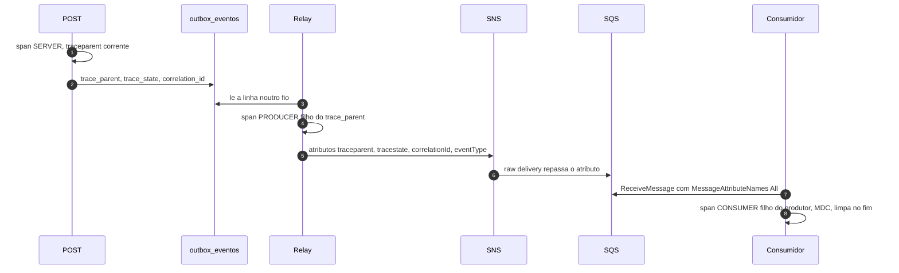

# 07 — Observabilidade

Instrumentação OpenTelemetry na aplicação. Destino local: `grafana/otel-lgtm` (Loki, Tempo, Mimir, Grafana). Destino AWS: sidecar ADOT para CloudWatch e X-Ray ([ADR 0013](04-adr/0013-observabilidade-otel.md)). A propagação através da fila é o [ADR 0025](04-adr/0025-rastreabilidade-contexto.md). A escolha de não operar Loki em produção, por enquanto, é o [ADR 0027](04-adr/0027-observabilidade-oss-vs-saas.md).

Log JSON. Sem descrição de lançamento, sem valor em INFO, sem token, sem `Authorization`.

## 1. Contexto no HTTP

Dois mecanismos, os dois obrigatórios.

**W3C Trace Context.** Headers `traceparent` e `tracestate`, na entrada e na saída, via Micrometer Tracing com a ponte OpenTelemetry. Um `traceparent` válido é `00-{trace-id de 32 hex}-{parent-id de 16 hex}-{flags}`. Flags `01` significa amostrado. O serviço continua o trace que chegou. Se não chegou, abre um trace novo.

**`X-Correlation-Id`.** Se o request trouxer um UUID, esse é o `correlationId`. Se vier ausente, vazio ou com outro formato, o serviço gera um UUID. A resposta devolve o mesmo header, inclusive no 4xx e no 5xx. O MDC leva o campo `correlationId`. O cliente de caixa guarda esse valor. Ele não precisa saber W3C.

Os dois não se substituem. O trace id é do tracer. O correlation id é da jornada, estável para o suporte, e atravessa a fila mesmo quando a amostragem decide não guardar o span.

## 2. Campos obrigatórios do log

Uma linha JSON, campos no topo (structured logging do Boot):

| Campo | Quando |
|---|---|
| `traceId` | sempre, no fio de uma requisição ou de uma mensagem |
| `spanId` | sempre, junto do trace |
| `correlationId` | sempre, nesses mesmos fios |
| `service.name` | sempre |
| `comercianteId` | depois que o tenant é conhecido (token válido, ou evento já traduzido) |
| `lancamentoId` | no POST que gravou, no estorno, e no consumo do evento daquele lançamento |
| `eventId` | na outbox e no consumo |

`traceId` e `spanId` no MDC são os da W3C (32 e 16 hex), não o formato `1-...` do console do X-Ray.

### O mesmo trace no POST e no consumo

Medido em 2026-11-10 no Compose, com `X-Correlation-Id: c4d5e6f7-8091-4a2b-8c3d-4e5f60718293`. O `traceId` comum é `5c31753c7c9eebe969f69289ba632f8f`. As linhas abaixo são as que os containers imprimiram, sem token.

Requisição, no `lancamentos-service`:

```json
{"@timestamp":"2026-11-10T23:24:20.970Z","level":"INFO","logger":"br.com.fluxocaixa.lancamentos.config.LogDeRequisicao","message":"Requisição POST /api/v1/lancamentos status=201","service":"lancamentos-service","traceId":"5c31753c7c9eebe969f69289ba632f8f","spanId":"e079d3d23bf8d0c8","correlationId":"c4d5e6f7-8091-4a2b-8c3d-4e5f60718293","comercianteId":"11111111-1111-1111-1111-111111111111","lancamentoId":"01a1c7c6-dc4a-70dd-aecd-03828f5ed8ef"}
```

Publicação do outbox, no mesmo serviço, outro `spanId`:

```json
{"@timestamp":"2026-11-10T23:24:21.284Z","level":"INFO","logger":"br.com.fluxocaixa.lancamentos.adapters.out.messaging.ProcessadorDeOutbox","message":"Evento de outbox publicado","service":"lancamentos-service","traceId":"5c31753c7c9eebe969f69289ba632f8f","spanId":"c4f0ee7f6b7abe4d","correlationId":"c4d5e6f7-8091-4a2b-8c3d-4e5f60718293","comercianteId":"11111111-1111-1111-1111-111111111111","lancamentoId":"01a1c7c6-dc4a-70dd-aecd-03828f5ed8ef","eventId":"01a1c7c6-dc5a-706e-a94f-4135c79b9329"}
```

Consumo, no `consolidado-service`, o mesmo `traceId`, o mesmo `correlationId` e o mesmo `eventId`:

```json
{"@timestamp":"2026-11-10T23:24:21.273992585Z","@version":"1","message":"Evento de lançamento consolidado","logger_name":"br.com.fluxocaixa.consolidado.adapters.in.messaging.ProcessadorEventoLancamento","thread_name":"virtual-134","level":"INFO","level_value":20000,"traceId":"5c31753c7c9eebe969f69289ba632f8f","spanId":"d35330fe0bfdc05f","eventId":"01a1c7c6-dc5a-706e-a94f-4135c79b9329","correlationId":"c4d5e6f7-8091-4a2b-8c3d-4e5f60718293","comercianteId":"11111111-1111-1111-1111-111111111111"}
```

O Tempo do `otel-lgtm` devolveu esse trace em `http://localhost:3000/api/datasources/proxy/uid/tempo/api/traces/5c31753c7c9eebe969f69289ba632f8f` (a porta 3200 do Tempo não está publicada no host; o Grafana faz o proxy). No mesmo trace aparecem os dois serviços, com `service.name` igual ao `OTEL_SERVICE_NAME` do Compose (`lancamentos` e `consolidado`):

- `lancamentos`: `http post /api/v1/lancamentos` (SERVER) e `publicar-lancamento` (PRODUCER)
- `consolidado`: `consolidado.consumir.lancamento` (CONSUMER)

O perfil `local` e o `aws` do lançamentos exportam OTLP de trace para `${OTEL_EXPORTER_OTLP_ENDPOINT}/v1/traces`, no mesmo formato que o consolidado. Sem esse endpoint, o log tinha `traceId` e o Tempo só recebia o consumidor.

## 3. Da outbox até o consumidor



O relay não herda o MDC da thread do POST. A thread do agendador não tem esse contexto. A fonte é a coluna. Publicar “o trace de agora” abriria um trace órfão, filho de ninguém, e o exemplo da seção 2 não fecharia.

Atributos SNS, tipo `String`, repassados pelo raw delivery: `eventType`, `traceparent`, `tracestate` quando existir, `correlationId`. O JSON do evento não ganha esses campos.

Spans: kind `PRODUCER` no publish, kind `CONSUMER` no receive. Nome estável (`lancamento publish`, `lancamento process`) para o Tempo e o X-Ray agruparem. Atributos de span: `eventId`, `lancamentoId`, `comercianteId`, `messaging.system=aws_sqs` no consumidor e `aws_sns` no produtor. Sem o valor do lançamento e sem a descrição.

Amostragem: a decisão é a do pai. POST amostrado implica produtor e consumidor amostrados. Decisão independente nos dois processos faz o trace sumir no meio.

No X-Ray o trace único é POST → relay → SNS → SQS → consolidação, desde que o exportador receba o contexto que o consumidor extraiu. Sem `MessageAttributeNames=All`, o X-Ray mostra dois traces e o log mostra dois `traceId`.

## 4. Achar o trace a partir do log, e o contrário

### Grafana local (Tempo e Loki)

O Compose sobe o `otel-lgtm` na porta 3000. Serviço exporta OTLP para `http://localhost:4318` no perfil `local`.

1. Explore → Tempo. Colar o `traceId` de 32 hex. O trace mostra o span HTTP, o span do produtor e o span do consumidor.
2. Explore → Loki. A linha do POST e a do consumo:

```logql
{service_name=~"lancamentos-service|consolidado-service|lancamentos|consolidado"} | json | traceId="5c31753c7c9eebe969f69289ba632f8f"
```

Pelo id que o cliente guardou:

```logql
{service_name=~"lancamentos-service|consolidado-service|lancamentos|consolidado"} | json | correlationId="c4d5e6f7-8091-4a2b-8c3d-4e5f60718293"
```

3. Derived field no Loki, do `traceId` para o Tempo, para o clique na linha abrir o trace. Sem o derived field, a correlação existe e o clique não. Vale a configuração uma vez no datasource local e, se um dia o Grafana de produção existir, de novo lá.

O `traceId` do Tempo local é o mesmo hex do log. Não há conversão.

### CloudWatch Logs Insights e X-Ray

O log do container chega como uma linha em `@message`. O Insights não promove o campo JSON sozinho em todo log group. O `parse` é o que funciona:

```sql
fields @timestamp, @message
| parse @message '"traceId":"*"' as traceId
| parse @message '"correlationId":"*"' as correlationId
| parse @message '"eventId":"*"' as eventId
| filter traceId = "4bf92f3577b34da6a3ce929d0e0e4736"
| sort @timestamp asc
```

Pelo correlation id, a mesma query com `filter correlationId = "7c9e6679-7425-40de-944b-e07fc1f90ae7"`. Os dois log groups (lançamentos e consolidado) entram no mesmo Insights, senão a segunda linha fica no outro grupo e o operador conclui que o consumidor não logou.

O console do X-Ray mostra o id no formato `1-{tempo em hex}-{24 hex}`. Não é o `traceId` de 32 caracteres do log. O exportador ADOT faz a conversão. Para achar o segmento a partir do log:

- filtrar no X-Ray pela annotation `correlation_id` (o sidecar deve promovê-la a annotation, não só a atributo de span, porque o filtro do console enxerga annotation);
- ou usar o id convertido que o exportador grava. Não se pede ao suporte para recalcular o id na mão.

O caminho do dia a dia em produção é: `requestId` do access log do API Gateway → `xrayTraceId` no mesmo JSON → `correlationId` (header e campo do log) → linha do serviço no Insights → annotation no X-Ray. O access log do stage traz `requestId`, `extendedRequestId`, `xrayTraceId`, `ip`, `status`, `latency`, `integrationLatency`, `apiKeyId`, `traceparent` e `correlationId`. O X-Ray do stage está ligado. O `traceparent` que o CloudFront repassa segue no mapeamento da integração, então o span do serviço continua filho do contexto que o cliente mandou. O caminho local continua o mesmo hex no Loki e no Tempo.

## 5. Métricas

| Métrica | Lançamentos | Consolidado |
|---|---|---|
| Rate | req/s por rota e status | req/s por rota e status |
| Errors | 5xx / total; 4xx separado (4xx não queima budget de disponibilidade) | idem |
| Duration | histograma do POST, do GET por id e da lista | histograma do GET diário e do período |

403 do WAF não aparece no histograma do serviço. Aparece no log do WAF. Os dois entram no painel de borda, separados, para um bloqueio não parecer queda da task.

### USE

| Recurso | Utilização | Saturação | Erro |
|---|---|---|---|
| Task ECS | CPU e memória | throttling de CPU | task stopped |
| RDS | CPU, IOPS de gp3, credit balance | conexões / `max_connections` | failover, erro de autenticação depois de rotação |
| Redis | CPU, memória, hit ratio | evictions | timeout, circuito aberto |
| SQS | mensagens visíveis, idade da mais antiga | a idade é a saturação | DLQ |

### Resilience4j

Estado do circuito (fechado, aberto, meio-aberto) do cliente SNS e do cliente Redis, taxa de chamada recusada, latência do bulkhead do consumidor. Saem no Prometheus. O health mostra o estado e não muda a readiness: circuito do Redis aberto com fallback no Postgres é degradação, não task doente.

### Caixa

| Métrica | Significado |
|---|---|
| `lancamentos_registrados_total{tipo}` | Fatos aceitos. Parado na hora em que deveria vender é incidente de negócio. |
| `lancamentos_estornados_total` | Volume de correção. |
| `consolidacao_eventos_aplicados_total` | Consumo efetivo. |
| `consolidacao_lag_seconds` | `aplicadoEm − occurredAt`. SLO p95 &lt; 5 s em regime. |
| `outbox_pendente` | Linhas com `publicado_em` nulo. |
| `outbox_idade_segundos` | Idade da mais antiga não publicada. |
| `sqs_idade_mensagem_segundos` | `ApproximateAgeOfOldestMessage`. |
| `sqs_mensagens_visiveis` | Backlog. |
| `sqs_dlq_visiveis` | Qualquer valor &gt; 0 é alarme. |
| `cache_hit_ratio` | A premissa de 80%. |

`eventId` e `comercianteId` são atributo de span, não dimensão de métrica.

## 6. Dashboards

Um por serviço e um de ponta a ponta.

**Lançamentos.** RED do POST, Hikari em uso contra o máximo, `outbox_pendente`, idade da outbox, taxa de 409, estado do circuito do SNS.

**Consolidado.** RED do GET, hit ratio, Hikari, lag, idade da mensagem, DLQ, estado do circuito do Redis, ocupação do bulkhead.

**Ponta a ponta.** Taxa de POST, taxa de evento aplicado, lag p95, e o painel “consolidado fora, lançamentos ok”.

**Borda.** 4xx e 5xx da distribuição CloudFront, bloqueio do WAF por regra, e o widget do API Gateway no dashboard `operacao`: Count, 4XX, 5XX, Latency p99 e IntegrationLatency p99. Sem este painel, o SLO medido no serviço e o tempo que o comerciante vê ficam na mesma curva e a conversa de RTT ([ADR 0021](04-adr/0021-regiao-us-east-1.md)) não tem dado.

No local, o Grafana em `http://localhost:3000` já recebe OTLP. O explore da seção 4 é a verificação, mesmo antes do JSON do dashboard existir na infra.

## 7. Alarmes

Limiares iniciais. Todos no tópico SNS operacional. O alarme não corrige sozinho.

| Alarme | Condição | Por que esse número |
|---|---|---|
| 5xx lançamentos | &gt; 1% por 5 min, pelo menos 20 req | Acima de uma falha isolada, abaixo de queimar o budget em silêncio |
| 5xx consolidado | &gt; 1% por 5 min | A meta interna. 5% é o teto do enunciado, não o alarme |
| p99 POST | &gt; 500 ms por 10 min, medido no serviço | Igual ao SLO server-side |
| p99 GET consolidado | &gt; 300 ms por 10 min | Igual ao SLO |
| Readiness | target unhealthy | O ECS já substitui; o alarme é para o humano |
| Outbox pendente | &gt; 100 linhas ou idade &gt; 30 s por 5 min | Relay de 500 ms não justifica 30 s |
| Idade da mensagem SQS | &gt; 30 s por 5 min em regime | Acima do SLO de 5 s, com folga de um retry |
| DLQ &gt; 0 | qualquer mensagem | Poison message é anormal |
| API Gateway 5XX | soma &gt; 5 em 1 min, 2 de 3 períodos | Falha de integração ou 5xx do serviço visto pelo gateway |
| API Gateway 4XX | soma &gt; 100 em 1 min, 2 de 3 períodos | Volume anormal de token inválido ou contrato recusado. Não é 5xx |
| API Gateway Latency p99 | &gt; 1 s | Métrica em milissegundos. Acima do SLO do processo mais o hop |
| API Gateway IntegrationLatency p99 | &gt; 800 ms | O backend passou de 800 ms. O timeout da integração é 10 s |
| RDS conexões | &gt; 70% de `max_connections` | Antes de recusar conexão. Disparar com o teto de tasks ainda longe indica leak |
| RDS CPU credit | balance em queda por 30 min | Gatilho de classe, e um dos gatilhos de réplica do [documento 12](12-desempenho-e-dados.md) |
| Redis evictions | &gt; 0 sustentado | Memória curta |
| Circuito Redis aberto | aberto por 5 min | Fallback no Postgres acontecendo de verdade |
| Circuito SNS aberto | aberto por 5 min | Outbox vai acumular; o POST segue |
| `RotationFailed` | qualquer evento | A senha não girou. O 500 de autenticação é o alarme atrasado. [ADR 0024](04-adr/0024-rotacao-de-segredos.md) |
| Certificado ACM | menos de 14 dias e renovação não concluída | A renovação gerenciada falhou em silêncio |

Alarme de “fila com mensagem” não existe. Fila com mensagem é o sistema funcionando. O sinal é a idade.

## 8. Runbooks

### Saldo atrasado, POST normal

1. Ver `consolidacao_lag_seconds` e a idade da mensagem mais antiga.
2. Buscar o `correlationId` do POST no Insights, nos dois log groups. Se a linha do consumidor não existe e a outbox está velha, o relay ou o SNS parou. Ver o estado do circuito do SNS.
3. Se a outbox está em dia e a idade da fila sobe, o consumidor parou ou está lento. Ver readiness e erro de banco.
4. Se há DLQ, ir para o runbook de DLQ. Não reprocessar no escuro.
5. Dizer ao comerciante: o lançamento está durável; o relatório atrasou. Não pedir para lançar de novo.

### Consolidado fora

1. Confirmar que o target group de lançamentos segue saudável. Se não segue, não é o incidente isolado.
2. Deixar a fila acumular. Não desligar o relay: a outbox esvazia para a fila, que retém 14 dias.
3. Corrigir a causa.
4. Ao voltar, observar a drenagem. Premissa: cerca de 100 evt/s por task. 72 mil mensagens (1 h a 20 evt/s) levam cerca de 6 minutos com duas tasks.
5. O SLO de lag de 5 s não vale durante o catch-up. O alarme de idade fica silenciado só nessa janela.

### Mensagem na DLQ

1. Ler o corpo e o `eventType`. O v1 não tem descrição; não inventar log dela.
2. Bug corrigido e `eventId` ainda válido: redrive para a fila principal. O consumidor idempotente torna o redrive seguro.
3. Versão desconhecida: parar o produtor novo. Não alargar o consumidor para engolir o contrato.
4. Lixo: descartar com registro do `eventId` e da razão.

### POST lento

1. No trace, separar JWT, commit e tempo total. O RTT até a Virgínia não está nesse trace: ele está na frente, entre o edge e o ALB. Se o cliente reclama de 300 ms e o span do servidor mostra 80 ms, a diferença é o backbone, não o RDS.
2. Se o commit domina, olhar lock, crédito de CPU do RDS e o índice parcial da outbox.
3. Se o JWT domina, o JWKS não está em cache ou o Cognito está inalcançável.

### Redis fora

1. O GET deve continuar 200, mais lento. Se a readiness caiu, a probe está errada (Redis não pode matar a task). Corrigir a probe antes de escalar, senão o ECS reinicia em círculo.
2. Failover do ElastiCache ou recriação do nó. A projeção no Postgres é a fonte.

### Rotação falhou

1. O alarme `RotationFailed` é o começo, não o 5xx.
2. Seguir o runbook do [ADR 0024](04-adr/0024-rotacao-de-segredos.md): um segredo por vez, wrapper rebusca, `maxLifetime` de 15 minutos limita a conexão velha, deployment novo corta a espera.
3. Confirmar conexão nova em `pg_stat_activity` e o fim do 5xx.

### Erro de budget

1. Queima rápida: parar deploy que não seja correção.
2. Olhar o WAF (bloqueio súbito de IP legítimo) antes de culpar a task. 403 de WAF não é 5xx, e o cliente vive os dois como “sistema fora”.

## 9. Ambiente local

| Porta | Uso |
|---|---|
| 3000 | Grafana (`admin` / `admin` quando a imagem pedir) |
| 4317 | OTLP gRPC |
| 4318 | OTLP HTTP, valor de `OTEL_EXPORTER_OTLP_ENDPOINT` |

O que validar com `make up` e um POST:

1. A linha do POST tem `traceId`, `spanId` e `correlationId`.
2. A resposta traz `X-Correlation-Id`.
3. Segundos depois, a linha do consumidor tem o mesmo `traceId` e o mesmo `correlationId`.
4. O Tempo mostra os três spans (HTTP, produtor, consumidor) num trace só.
5. A métrica de lançamento registrado incrementa.

Sem o item 3, o dashboard de produção nasce cego. O passo está no [README da raiz](../README.md).

## 10. O que fica de fora de propósito

Profiling contínuo, RUM (não há frontend), log de SQL em INFO, métrica por comerciante, e um Grafana self-hosted em produção antes do time de plataforma. Contagem por comerciante, se o negócio pedir, é consulta no banco, não label de métrica.
