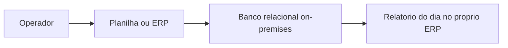
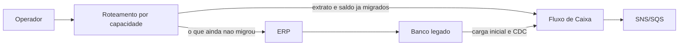
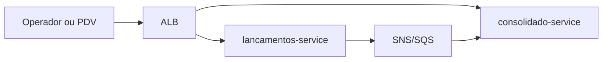

# 09 — Arquitetura de transição

Os dois serviços nascem no contorno certo. Não há monolito nosso para estrangular. O que existe no comerciante, quase sempre, é uma planilha ou um ERP on-premises com um banco relacional onde o “lançamento” é uma linha editável. A transição é o caminho desse legado até o Fluxo de Caixa, sem um fim de semana em que o caixa para e os números não fecham.

O padrão é **Strangler Fig**: o legado continua operando, o sistema novo assume fatias do fluxo, e o legado só sai quando a fatia nova já é a fonte da verdade.

## 1. Estado atual (legado)

Características que mudam o desenho da migração:

- Lançamento editável e apagável. O sistema novo não aceita isso ([ADR 0015](04-adr/0015-lancamentos-imutaveis-estorno.md)).
- Saldo calculado na hora, muitas vezes com fórmula que arredonda em ponto flutuante.
- Um único banco. Relatório e escrita caem juntos — exatamente o oposto do RNF crítico.
- Sem `comerciante_id` de UUID. O “tenant” é a instalação inteira, ou uma coluna `loja`.

## 2. Estado de transição

O roteador não é um produto novo obrigatório. No início pode ser o próprio processo do operador: “venda do balcão já vai na API; o contas a pagar do ERP continua no ERP”. Um gateway entra só quando as duas UIs precisam parecer uma.

## 3. Estado alvo

O legado não aparece. Relatório antigo, se ainda for exigido por um contador, lê a API de período — não o banco novo por baixo.

## 4. Fases

### Fase 0 — Inventário

Mapear, na planilha ou no ERP, o que é lançamento de caixa e o que é outra coisa (pedido, nota, boleto). Só o movimento de crédito e débito com data de competência entra. Definir a tradução para `CREDITO`/`DEBITO`, a moeda (se aparecer outra que não BRL, a migração para e o [ADR 0016](04-adr/0016-representacao-monetaria.md) é reaberto), e o UUID do comerciante que será o claim.

Critério de saída: uma tabela de de-para assinada por quem opera o caixa, com exemplos reais de estorno no legado (muitas vezes um delete, às vezes uma linha negativa).

### Fase 1 — Carga inicial

Extrair o histórico que precisa ser consultado (sugestão: exercício corrente mais o anterior) e gravar via API de lançamentos, não via `INSERT` direto no Postgres do serviço. A API aplica dinheiro, tenant e outbox. O consolidado reconstrói o saldo pelo evento, e o `SUM` vira a prova.

Idempotency-Key = chave natural do legado (`sistema`, `tabela`, `id`). Reexecutar a carga não duplica.

Linha negativa ou deletada no legado vira par lançamento + estorno, não um valor negativo — o domínio novo não tem valor negativo.

Critério de saída: para uma amostra de dias, o saldo do consolidado empata com o relatório do legado no centavo. Diferença vai para uma lista de exceção, não para “ajuste manual no banco”.

### Fase 2 — Coexistência com CDC

Enquanto o operador ainda lança nos dois mundos, o legado continua mudando. AWS DMS (ou CDC equivalente) lê o banco on-premises e empurra mudança para um adaptador. O adaptador é ACL: traduz linha editável em comando `RegistrarLancamento` ou `EstornarLancamento`. Não escreve na tabela do serviço.

Update no legado vira estorno do fato anterior mais lançamento novo, porque o sistema novo não tem update. Delete vira estorno. A chave de idempotência estável é o que impede o CDC de reaplicar a mesma mudança.

O sentido inverso (novo → legado) só existe se um relatório antigo ainda não migrado precisar ver o movimento novo. Aí o evento `LancamentoRegistrado` ganha um consumidor de sincronização, fila própria, sem reutilizar a fila do consolidado. Se nenhum relatório antigo precisar, não se constrói a volta. Sincronizar nos dois sentidos sem dono é a forma mais rápida de duplicar saldo.

### Fase 3 — Roteamento progressivo

Ordem sugerida, da capacidade mais isolada para a mais arriscada:

1. Consulta de saldo e de período no sistema novo, em paralelo ao relatório velho, sem desligar o velho. O operador compara.
2. Extrato do dia (GET de lançamentos) no sistema novo.
3. Escrita de um tipo de movimento (por exemplo venda do balcão) só na API nova. O CDC deixa de reimportar esse tipo, senão duplica.
4. Escrita dos demais tipos.
5. Estorno só na API nova.

Cada passo tem um interruptor (configuração ou feature flag) para voltar o roteamento. Não se apaga o legado no mesmo dia em que se desvia o tráfego.

### Fase 4 — Desligamento

Quando, por um ciclo de fechamento inteiro, o saldo novo e o legado empatam e ninguém escreve mais no legado:

1. Parar o CDC.
2. Somente leitura no ERP por um período combinado (30 a 90 dias).
3. Arquivar o banco legado. Não se migra esse arquivo para `us-east-1`.
4. Remover o adaptador e a fila de sincronização.

## 5. Riscos e mitigação

| Risco | Mitigação |
|---|---|
| Dupla escrita (operador lança nos dois) | Uma capacidade, um sistema dono, por fase. Idempotency-Key da carga. Conciliação diária dos totais. |
| CDC reaplicado | Chave natural do legado na idempotência. Consumidor que não faz `INSERT` cru. |
| Arredondamento do legado não fecha centavo | Relatório de diferença por dia antes de desligar. Não “arredondar para bater”. |
| Update do legado sem par no modelo novo | Tradução explícita para estorno + novo lançamento, testada com casos reais da fase 0. |
| Saldo do novo atrasado e o operador compara no mesmo segundo | A comparação de convivência usa o lag conhecido (p95 &lt; 5 s) e, na carga, espera a fila zerar. |
| Segredo do banco on-premises na conta AWS | DMS com segredo no Secrets Manager, rede privada (VPN ou Direct Connect), usuário de leitura do legado, não o dono do schema. |
| Escopo crescendo para nota fiscal e boleto | Fora de escopo. O strangler é do caixa, não da suíte inteira do ERP. |

## 6. Rollback

Rollback de fase é devolver o roteamento, não restaurar banco por cima.

| Fase em que o problema aparece | Rollback |
|---|---|
| Carga inicial | Apagar o ambiente novo ou os lançamentos da carga (ainda não há produção real) e corrigir o de-para. Se a carga já convive com movimento novo, não se apaga: estorna-se o lote, com chave de lote para achar as linhas. |
| CDC | Desligar a task de replicação. O legado segue como estava. O novo pode ter fatos a mais: estorno do lote afetado, não `DELETE`. |
| Roteamento de leitura | Apontar a consulta de volta ao ERP. Sem migração de dado. |
| Roteamento de escrita | Fechar a flag de escrita na API. Movimento que já entrou no novo permanece e segue para o saldo. O legado não reabre para o mesmo movimento sem o de-para, senão o dia fica duplo. |
| Desligamento | Só é seguro enquanto o legado está em somente leitura e o CDC pode ser religado. Depois do arquivamento, o rollback é restaurar backup do legado, com RTO medido em dia, não em hora. Por isso a fase 4 tem período de somente leitura. |

Não há rollback que “desfaça o strangler” reescrevendo o Postgres novo a partir do ERP sem passar pela API. Esse atalho fura outbox, idempotência e trilha.

## 7. O que não se faz na transição

- Replicação bidirecional permanente como estado final.
- Manter o relatório do ERP lendo o RDS novo com usuário compartilhado.
- Aceitar valor negativo “só na migração” e limpar depois.
- Big bang na sexta-feira de fechamento de mês.

A arquitetura-alvo não muda por causa da transição. O que a transição adiciona — adaptador de ACL, fila extra, DMS — é temporário e tem data de desligamento. Sem essa data, o strangler vira dois sistemas para sempre.
