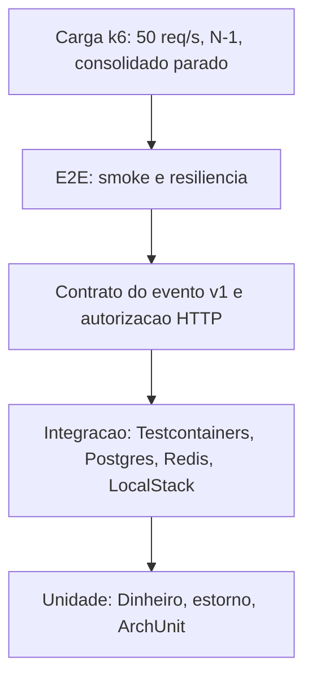

# 11 — Testes

A estratégia cobre a regra de dinheiro, o isolamento entre os serviços e o pico de 50 req/s. Teste que só sobe a aplicação e recebe 200 não segura o RNF crítico.

## 1. Pirâmide



A base é larga de propósito. Estorno duplo e escala de dinheiro não precisam de Docker. A ponta é estreita e cara: k6 não roda a cada commit, roda no candidato a release ou sob demanda.

| Camada | Onde | O que prova |
|---|---|---|
| Unidade | `domain` e casos de uso com portas falsas | Valor rejeitado, estorno único, estorno de estorno, descrição do estorno, soma comutativa do saldo |
| ArchUnit | teste no build de cada serviço | `domain` sem Spring e sem `adapters`; `application` sem `adapters` |
| Integração | Testcontainers: PostgreSQL 17, Redis, LocalStack | Transação de outbox, relay publica, consumidor aplica uma vez, reentrega não duplica, Flyway sobe limpo |
| Contrato | Teste de serialização do JSON do blueprint e, na evolução, Pact | `valor` string com duas casas, campo desconhecido ignorado, versão desconhecida não aplicada |
| Autorização | MockMvc ou equivalente com tokens de dois comerciantes | 401, 403, 404 cruzado, claim ignorada se vier no corpo |
| E2E smoke | `tests/e2e/smoke.sh` via `make smoke` | Sobe a jornada: token, POST, GET do lançamento, GET do saldo depois do lag |
| Resiliência | `tests/e2e/resiliencia.sh` via `make resiliencia` | Consolidado parado, POST segue 201, fila acumula, volta e o saldo alcança |
| Carga | `tests/load` via `make load` | Cenários do [documento 05](05-requisitos-nao-funcionais.md) |
| Segurança estática | SAST no CI (CodeQL ou equivalente) e Dependabot | Dependência e padrão perigoso |
| Segurança dinâmica | Evolução: ZAP baseline contra o local | Não bloqueia esta entrega; o teste de autorização cobre BOLA e BFLA |

Não se mocka o Postgres para provar `SKIP LOCKED` nem índice único de estorno. Isso é teste de integração. Mock de relógio e de porta de publish, no unitário do caso de uso, é o lugar certo.

## 2. O que cada RNF exige de teste

| RNF | Teste mínimo |
|---|---|
| Independência do consolidado | `make resiliencia` |
| 50 req/s e perda &lt; 1% | k6 de leitura nominal |
| Idempotência HTTP | Integração: dois POST com a mesma chave; um com a mesma chave e outro corpo (409) |
| Idempotência do consumidor | Integração: a mesma mensagem duas vezes, um saldo só |
| Dinheiro | Unidade: `10.125` rejeitado, `0` rejeitado, soma de centavos |
| Tenant | Dois tokens, o id do outro retorna 404 |
| Outbox | Integração: derrubar o publish, ver a linha com `publicado_em` nulo, restaurar, ver a publicação |

## 3. Como executar

Pré-requisitos e a subida do ambiente estão no [README da raiz](../README.md). Os alvos do Makefile:

| Alvo | Função |
|---|---|
| `make infra-up` | Postgres, Redis, LocalStack, Keycloak, Grafana/OTel |
| `make up` | Sobe `lancamentos-service` e `consolidado-service` |
| `make down` | Derruba o ambiente local |
| `make test` | Testes de build dos dois serviços (unidade, ArchUnit, integração) |
| `make token` | Imprime um access token do usuário `comerciante1` |
| `make smoke` | Jornada feliz ponta a ponta (`tests/e2e/smoke.sh`) |
| `make resiliencia` | Consolidado indisponível e recuperação (`tests/e2e/resiliencia.sh`) |
| `make load` | k6, se instalado (`tests/load`) |
| `make tf-validate` | `terraform fmt -check` e `validate` em `infra/terraform` |

Ordem local típica:

```bash
make infra-up
make up
make token
make smoke
make resiliencia
make test
```

`make load` exige k6 instalado e o ambiente no ar. Não aponta para produção.

Integração com Testcontainers precisa de Docker, o mesmo daemon do Compose. Se o Docker não estiver acessível, o teste de integração falha de verdade — não se pula em silêncio no CI.

## 4. Dados de teste

Usuário local: `comerciante1` / `comerciante1`, claim `comerciante_id=11111111-1111-1111-1111-111111111111`.

Não se usa cópia de produção. Carga de teste cria os próprios lançamentos e, no k6, chave de idempotência por iteração para a repetição do runner não parecer “perda” nem “duplicata”.

## 5. CI

Workflow em `.github/workflows`, em duas velocidades:

1. **Push e pull request, filtrados por caminho.** `.github/workflows/ci.yml` roda `./mvnw -B verify` em `services/lancamentos-service` e `services/consolidado-service` com Java 25 (Temurin) quando muda `services/**`. `.github/workflows/terraform.yml` roda `terraform fmt -recursive -check` e `terraform init -backend=false && terraform validate` em `infra/terraform/envs/dev` e `envs/prod` quando muda `infra/terraform/**`. O `make test` e o `make tf-validate` locais fazem o mesmo. Não sobe o Compose inteiro.
2. **No candidato a release, ou manual.** Compose, `make smoke`, `make resiliencia`. k6 fica manual ou noturno: dez minutos a 50 req/s num runner compartilhado compete com o resto da organização e não precisa ser a cada commit.

Falha de ArchUnit, de teste de estorno ou de contrato do evento quebra o build. Falha de smoke no release bloqueia a imagem. Alarme de produção não substitui isso: quando o alarme toca, o lançamento ruim já passou.

## 6. Evidência local medida em 2026-11-10

<a id="evidencia-local"></a>

Ambiente: `make up` neste repositório, um container de cada serviço, Postgres 17, Redis 7, LocalStack, Keycloak e `grafana/otel-lgtm`. Não é a topologia de duas tasks da AWS e não substitui o cenário de 10 minutos da seção de carga do [documento 05](05-requisitos-nao-funcionais.md).

`make test`: `lancamentos-service` 46 testes, `consolidado-service` 43 testes, os dois com `BUILD SUCCESS` (unidade, ArchUnit e Testcontainers).

`make smoke`: crédito 150, débito 40 e estorno do débito. Saldo consolidado do dia convergiu para `150.00`.

`make resiliencia`: com o consolidado parado, os dois POST responderam 201. Depois de religar, o saldo do dia `2099-01-15` convergiu para 7 (10 de crédito e 3 de débito).

Carga, 1 minuto, k6 local (`DURATION=1m POST_RATE=1 k6 run tests/load/consolidado-pico.js`): 50 GET/s no consolidado e 1 POST/s no lançamentos.

| Métrica | Consolidado (GET) | Lançamentos (POST) | Total |
|---|---:|---:|---:|
| Taxa de erro HTTP | 0,00% | 0,00% | 0,00% (0 de 3.063) |
| p95 | 6,19 ms | 19,91 ms | 6,74 ms |
| p99 | 9,48 ms | 22,86 ms | 14,86 ms |
| Checks | 100% `consolidado 200` | 100% `lancamento aceito` | 3.063/3.063 |

Os limiares do script passaram (`p95` do consolidado abaixo de 100 ms, `p95` do lançamentos abaixo de 500 ms, erro abaixo de 5%). O Grafana em `localhost:3000` recebeu traces dos dois serviços no Tempo (`service.name` = `lancamentos-service` e `consolidado-service`). `/actuator/prometheus` e o Swagger UI responderam nos dois serviços.

## 7. Lacunas conscientes

- Blue/green com teste sintético no target group ainda não existe ([ADR 0020](04-adr/0020-estrategia-de-deploy.md)).
- Game day de failover do RDS é procedimento de nuvem, não script do repositório, até a conta dev existir.
- DAST completo não está no caminho crítico.
- Pact ainda não está ligado; o teste de serialização do exemplo do blueprint é o substituto inicial, descrito nas [evoluções](10-evolucoes-futuras.md).
