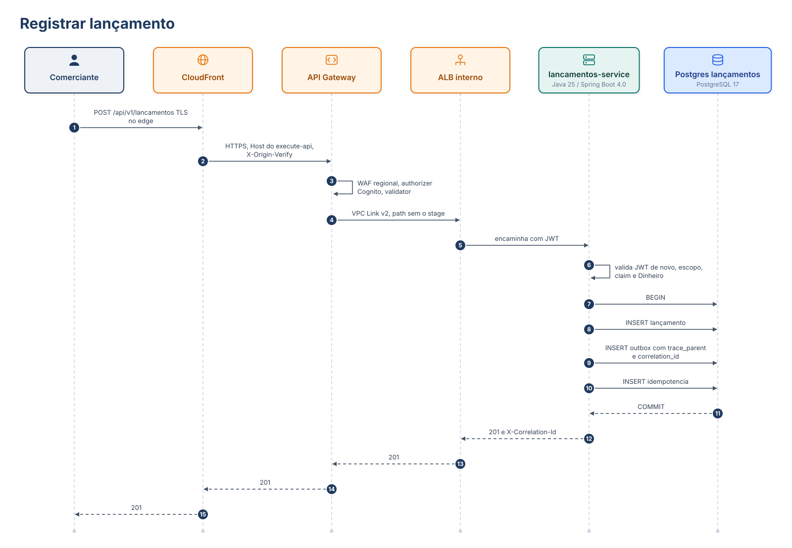
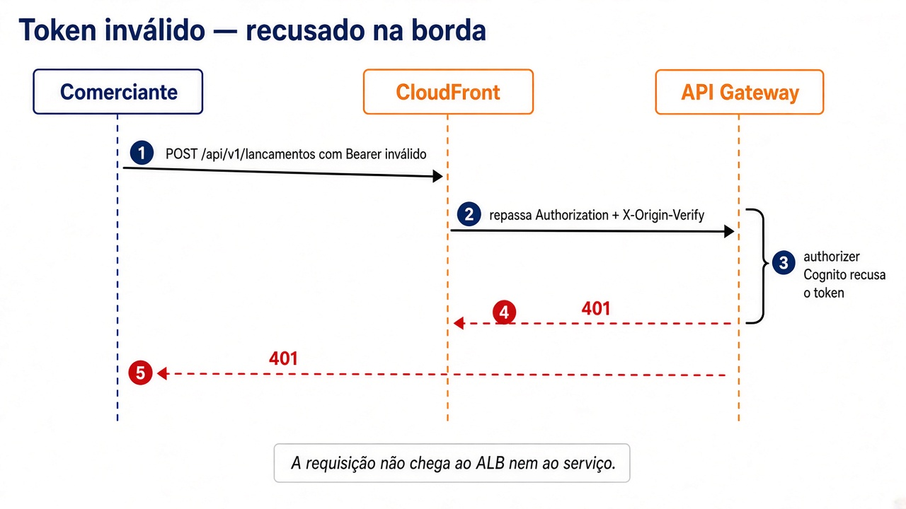
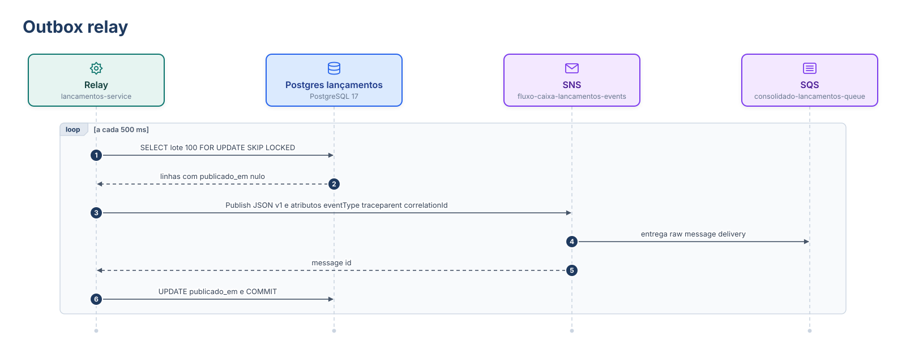
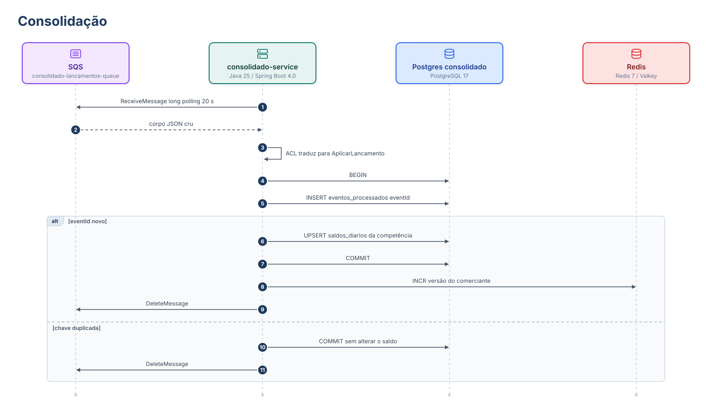
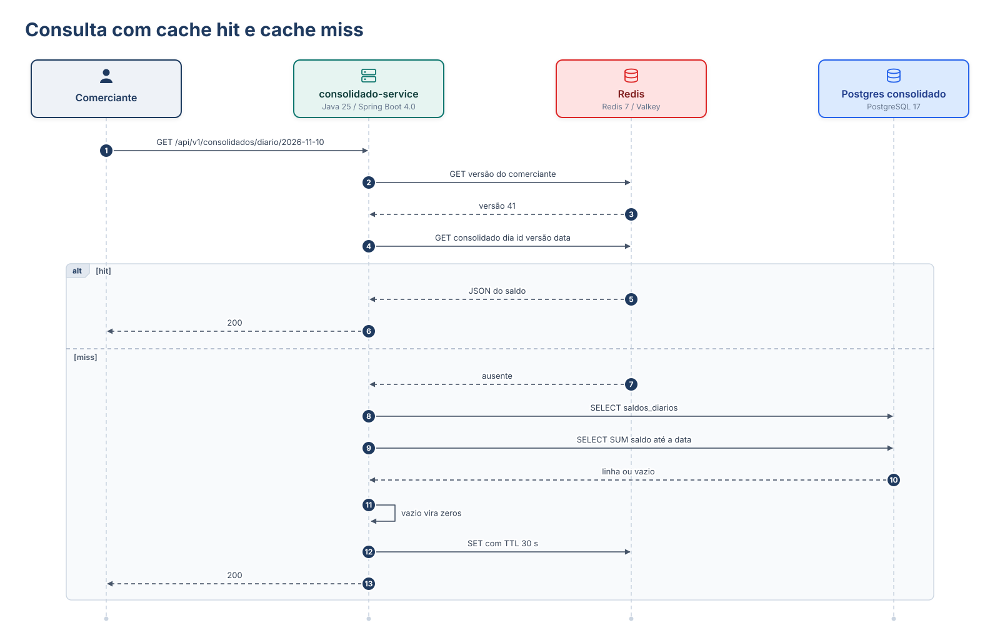
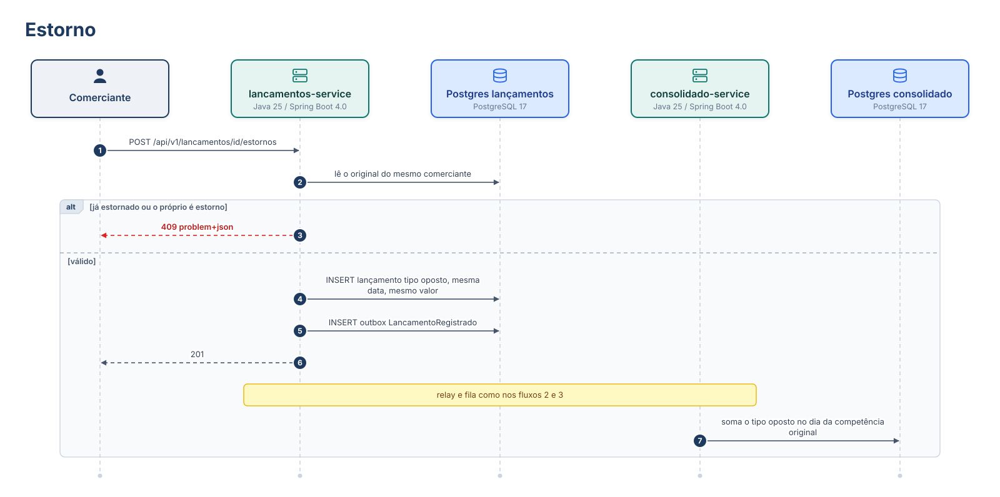
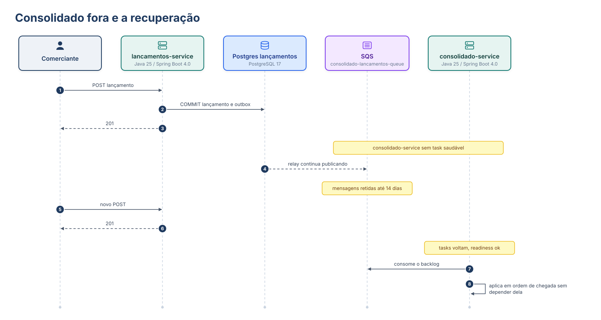
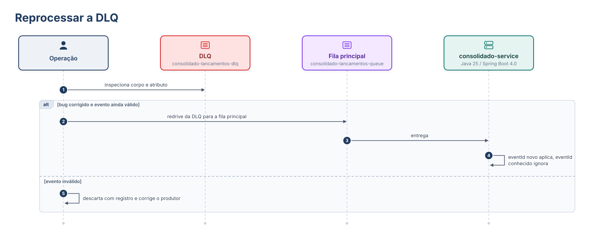

# Fluxos de dados

Nomes e tempos seguem o blueprint: tópico `fluxo-caixa-lancamentos-events`, fila `consolidado-lancamentos-queue`, DLQ `consolidado-lancamentos-dlq`, relay a cada 500 ms, visibility 60 s, `maxReceiveCount` 5, atraso de consolidação p95 &lt; 5 s.

## 1. Registrar lançamento

O POST termina no commit local. A publicação é outro fluxo.

Se o header `Idempotency-Key` repetir a mesma requisição, o fluxo para no `SELECT` da idempotência e devolve 200, sem segundo insert.

Token inválido não chega na task:

O WAF regional responde 403 se o header `X-Origin-Verify` não for o atual nem o anterior. Esse caso é chamada direta ao `execute-api`, não o comerciante passando pelo CloudFront. O serviço continua validando o JWT de quem passou: o gateway não substitui o resource server.

## 2. Outbox relay

Falha no `Publish`: a transação do lote não marca `publicado_em`, `tentativas` sobe, o próximo ciclo tenta de novo. Duas tasks não pegam a mesma linha por causa do `SKIP LOCKED`. O POST da seção anterior já respondeu ao comerciante antes deste loop.

## 3. Consolidação

O `INCR` da versão acontece depois do commit do saldo. Se o Redis falhar nesse momento, a versão antiga continua válida até o TTL de 30 s. Se o commit do banco falhar, a mensagem não é apagada e volta após o visibility timeout.

## 4. Consulta com cache hit e cache miss

O dia sem movimento não é miss eterno contra a tabela vazia: o serviço cacheia também a resposta zerada, para um cliente que insiste no mesmo dia não martelar o `SUM`.

## 5. Estorno

O saldo do dia corrente só muda se a competência do original for o dia corrente. Estorno de um crédito de ontem corrige ontem.

## 6. Consolidado fora e a recuperação

Durante a janela, `GET` no consolidado falha (entra no error budget de 99,5%). `POST` e `GET` de lançamentos seguem (SLO de 99,9%). Não há retry do cliente contra o consolidado embutido no POST.

Drenagem da premissa de 20 evt/s durante 1 h: 72.000 mensagens. Duas tasks a ~100 aplicações/s levam cerca de 6 minutos para alcançar o fim da fila. O p95 de 5 s vale para o regime estável, não para o catch-up depois de uma hora parado — o runbook trata esse catch-up como degradação esperada e medida pela idade da mensagem.

## 7. Reprocessar a DLQ

Uma mensagem chega na DLQ depois de 5 recebimentos. Causas típicas: JSON incompatível, `eventVersion` desconhecida, bug no `UPSERT`, poison message.

Redrive é seguro por causa do `eventId`. Não se edita a mensagem para “fazer passar”. Se o contrato estiver errado, a correção é `eventVersion` nova e consumidor que a entende.

## 8. O que cada fluxo garante

| Fluxo | Garantia | O que não garante |
|---|---|---|
| POST | Durabilidade do lançamento no commit | Saldo já visível |
| Relay | Publicação eventual com retentativa | Latência fixa se o SNS estiver degradado |
| Consumo | Soma única por `eventId` | Ordem entre eventos |
| GET com cache | Leitura rápida da última geração cacheada | Leitura monotonicamente fresca em todo miss concorrente |
| Queda do consolidado | POST segue | GET do saldo segue |
| DLQ | A fila principal não trava num poison message | O saldo daquele evento, até o redrive |
